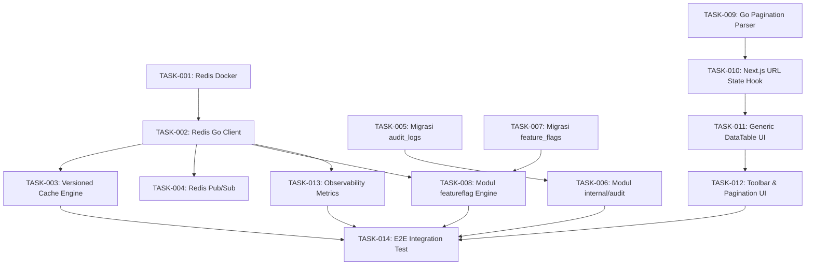

# Timeline & Dependensi — P02 Fondasi Platform

Dokumen ini memetakan urutan eksekusi, jalur kritis (critical path), dan dependensi antar-task dalam Fase P02 serta keterkaitannya dengan fase lanjutan (P03 s/d P08).

---

## 1. Diagram Alur Dependensi Task (DAG)

---

## 2. Jalur Kritis (Critical Path)
Jalur kritis pengerjaan Fase P02:
1. `TASK-P02-001` (Redis Docker) -> `TASK-P02-002` (Redis Client Go) -> `TASK-P02-003` (Versioned Cache) -> `TASK-P02-008` (Feature Flag Engine) -> `TASK-P02-014` (Verifikasi Integrasi).
2. `TASK-P02-005` (Migrasi SQL Audit) -> `TASK-P02-006` (Worker Audit Go) -> `TASK-P02-014`.

Kegagalan atau keterlambatan pada penyediaan Redis client atau migrasi audit logs akan menahan modul audit dan feature flag, yang selanjutnya memblokir fase P03 dan P04.

---

## 3. Matriks Ketergantungan Lintas Fase

| Komponen P02 | Digunakan Oleh Fase | Bentuk Ketergantungan |
|---|---|---|
| **Redis Shared Pool** | P03 (AI Gateway), P04 (Billing), P06 (Super Admin) | Rate limiter AI Gateway, session cache, realtime event broadcasting. |
| **Versioned Cache** | P04 (Subscription Engine), P06 (Super Admin) | Penegakan Realtime RBAC tanpa JWT refresh (K-14), cache profile user instan terinvalidasi saat subscription berubah. |
| **Audit Log Append-Only** | P03, P04, P05, P06, P07 | Pencatatan transaksi mutasi token AI, perubahan paket subscription, penerimaan pembayaran webhook, dan perubahan konfigurasi super admin. |
| **Feature Flags** | P03, P04, P05, P08 | Canary rollout endpoint AI Gateway v2, peluncuran gateway pembayaran Midtrans/Xendit baru, kill switch AI. |
| **Generic DataTable + URL State** | P06 (Super Admin), P07 (Audit UI) | Tampilan tabel manajemen user, daftar transaksi, riwayat audit logs, log penggunaan token. |
| **Observability Baseline** | P03, P04, P05, P08 | Metrik konsumsi token AI, error rate provider AI, durasi request webhook payment, saturation server. |

---

## 4. Jadwal Rilis & Milestones

- **Milestone M2.1 (Hari 3)**: Infrastruktur Redis berjalan, driver pool Go stabil, dan engine cache berversi lulus pengujian konkurensi.
- **Milestone M2.2 (Hari 5)**: Modul audit log aktif di PostgreSQL dengan trigger append-only dan asynchronous worker Go lulus uji benchmark.
- **Milestone M2.3 (Hari 7)**: Feature flag evaluator beroperasi dengan cache Redis dan fallback fail-closed; kontrak pagination backend siap.
- **Milestone M2.4 (Hari 9)**: Komponen `<DataTable>` generik frontend terintegrasi sempurna dengan search params URL di Next.js.
- **Milestone M2.5 (Hari 10)**: Seluruh metrik Four Golden Signals terekspos; test integrasi E2E P02 lulus; siap handover ke P03 (AI Gateway).
