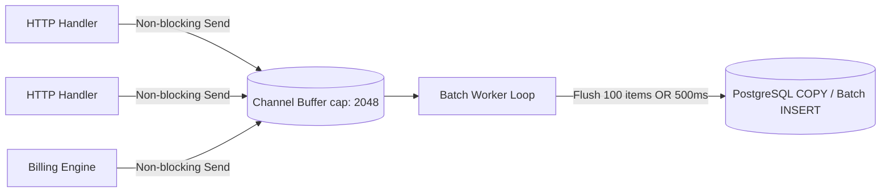

# Dokumen Teknis — Audit Logging & Kepatuhan UU PDP

## 1. Landasan Regulasi & Kepatuhan
Sesuai **UU PDP No. 27/2022** (Undang-Undang Pelindungan Data Pribadi) serta Keputusan Terkunci **K-29** dan **K-30**, seluruh tindakan pemrosesan data, perubahan wewenang administratif, dan mutasi finansial/token wajib dicatat secara permanen, tidak dapat diubah (*non-repudiable*), dan melindungi kerahasiaan data pribadi melalui sanitasi masking.

---

## 2. Struktur Database: Tabel Append-Only `audit_logs`

### 2.1. File Migrasi `0005_create_audit_logs.sql`
```sql
-- Up Migration: 0005_create_audit_logs.sql

CREATE TABLE IF NOT EXISTS audit_logs (
    id BIGSERIAL PRIMARY KEY,
    actor_id UUID NULL,
    actor_role VARCHAR(32) NOT NULL,
    action VARCHAR(64) NOT NULL,
    entity_type VARCHAR(64) NOT NULL,
    entity_id VARCHAR(128) NOT NULL,
    before_state JSONB NULL,
    after_state JSONB NULL,
    ip_address VARCHAR(45) NOT NULL DEFAULT '0.0.0.0',
    user_agent TEXT NOT NULL DEFAULT '',
    created_at TIMESTAMPTZ NOT NULL DEFAULT CURRENT_TIMESTAMP
);

-- Indexing untuk query pencarian & filter data audit
CREATE INDEX IF NOT EXISTS idx_audit_logs_actor_id ON audit_logs(actor_id);
CREATE INDEX IF NOT EXISTS idx_audit_logs_entity ON audit_logs(entity_type, entity_id);
CREATE INDEX IF NOT EXISTS idx_audit_logs_action ON audit_logs(action);
CREATE INDEX IF NOT EXISTS idx_audit_logs_created_at ON audit_logs(created_at DESC);

-- Trigger Immutability: Tolak UPDATE dan DELETE
CREATE OR REPLACE FUNCTION trg_enforce_audit_logs_append_only()
RETURNS TRIGGER AS $$
BEGIN
    RAISE EXCEPTION 'TABEL AUDIT_LOGS BERSIFAT APPEND-ONLY: Operasi % dilarang demi kepatuhan hukum.', TG_OP;
    RETURN NULL;
END;
$$ LANGUAGE plpgsql;

DROP TRIGGER IF EXISTS trg_audit_logs_no_update_delete ON audit_logs;

CREATE TRIGGER trg_audit_logs_no_update_delete
BEFORE UPDATE OR DELETE ON audit_logs
FOR EACH ROW
EXECUTE FUNCTION trg_enforce_audit_logs_append_only();
```

---

## 3. Desain Asynchronous Audit Worker di Go

### 3.1. Arsitektur Non-Blocking Buffer
Penulisan audit tidak boleh memperlambat latency jalur kritis HTTP request user. Digunakan pola **Buffered Go Channel** berkapasitas 2.048 event dengan pool batch writer.



### 3.2. Implementasi Modul `internal/audit`
```go
package audit

import (
	"context"
	"database/sql"
	"encoding/json"
	"log"
	"sync"
	"time"

	"github.com/google/uuid"
)

type Event struct {
	ActorID     *uuid.UUID             `json:"actor_id"`
	ActorRole   string                 `json:"actor_role"`
	Action      string                 `json:"action"`
	EntityType  string                 `json:"entity_type"`
	EntityID    string                 `json:"entity_id"`
	BeforeState map[string]interface{} `json:"before_state"`
	AfterState  map[string]interface{} `json:"after_state"`
	IPAddress   string                 `json:"ip_address"`
	UserAgent   string                 `json:"user_agent"`
}

type Service struct {
	db      *sql.DB
	queue   chan Event
	wg      sync.WaitGroup
	ctx     context.Context
	cancel  context.CancelFunc
	maxSize int
}

func NewService(db *sql.DB, bufferSize int) *Service {
	ctx, cancel := context.WithCancel(context.Background())
	s := &Service{
		db:      db,
		queue:   make(chan Event, bufferSize),
		ctx:     ctx,
		cancel:  cancel,
		maxSize: 100,
	}
	s.wg.Add(1)
	go s.workerLoop()
	return s
}

func (s *Service) Log(event Event) {
	// Sanitasi Data Sensitif sebelum masuk antrean
	event.BeforeState = SanitizePayload(event.BeforeState)
	event.AfterState = SanitizePayload(event.AfterState)

	select {
	case s.queue <- event:
	default:
		// Fallback darurat jika channel penuh: cetak ke log stream tanpa panik
		log.Printf("[AUDIT-OVERFLOW] Antrean penuh, event ter-drop: %s %s:%s", event.Action, event.EntityType, event.EntityID)
	}
}

func (s *Service) workerLoop() {
	defer s.wg.Done()
	ticker := time.NewTicker(500 * time.Millisecond)
	defer ticker.Stop()

	var batch []Event

	for {
		select {
		case <-s.ctx.Done():
			if len(batch) > 0 {
				s.flushBatch(batch)
			}
			return
		case event := <-s.queue:
			batch = append(batch, event)
			if len(batch) >= s.maxSize {
				s.flushBatch(batch)
				batch = nil
			}
		case <-ticker.C:
			if len(batch) > 0 {
				s.flushBatch(batch)
				batch = nil
			}
		}
	}
}

func (s *Service) flushBatch(events []Event) {
	// Menjalankan SQL Batch INSERT transaction
	tx, err := s.db.Begin()
	if err != nil {
		log.Printf("[AUDIT-ERROR] Gagal begin tx: %v", err)
		return
	}
	stmt, err := tx.Prepare(`
		INSERT INTO audit_logs (actor_id, actor_role, action, entity_type, entity_id, before_state, after_state, ip_address, user_agent)
		VALUES ($1, $2, $3, $4, $5, $6, $7, $8, $9)
	`)
	if err != nil {
		tx.Rollback()
		return
	}
	defer stmt.Close()

	for _, e := range events {
		beforeJSON, _ := json.Marshal(e.BeforeState)
		afterJSON, _ := json.Marshal(e.AfterState)
		_, _ = stmt.Exec(e.ActorID, e.ActorRole, e.Action, e.EntityType, e.EntityID, beforeJSON, afterJSON, e.IPAddress, e.UserAgent)
	}
	_ = tx.Commit()
}

func (s *Service) Shutdown() {
	s.cancel()
	s.wg.Wait()
}
```

---

## 4. Mekanisme Sanitasi Data Sensitif (Data Masking)
Sesuai prinsip Data Minimization UU PDP, field yang memuat kredensial atau rahasia wajib diganti dengan string `"[REDACTED]"`.

```go
package audit

import "strings"

var sensitiveKeys = map[string]bool{
	"password":      true,
	"token":         true,
	"secret":        true,
	"api_key":       true,
	"refresh_token": true,
	"card_number":   true,
	"cvv":           true,
	"pin":           true,
	"nik":           true,
}

func SanitizePayload(data map[string]interface{}) map[string]interface{} {
	if data == nil {
		return nil
	}
	sanitized := make(map[string]interface{})
	for k, v := range data {
		lowerKey := strings.ToLower(k)
		if sensitiveKeys[lowerKey] {
			sanitized[k] = "[REDACTED]"
			continue
		}
		if childMap, ok := v.(map[string]interface{}); ok {
			sanitized[k] = SanitizePayload(childMap)
		} else {
			sanitized[k] = v
		}
	}
	return sanitized
}
```

---

## 5. Kebijakan Retensi Data
- Seluruh baris `audit_logs` disimpan secara aktif selama **minimal 12 bulan (1 tahun)** di partisi operasional.
- Data yang melampaui masa 12 bulan diekspor ke cold storage terkompresi dan terenkripsi (AES-256) untuk pemenuhan kewajiban audit eksternal hingga 5 tahun, sebelum dapat dipurging melalui prosedur legal resmi.
