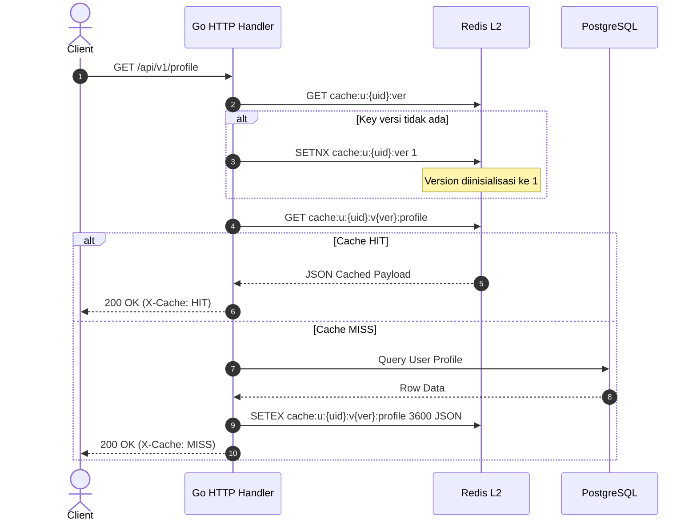

# Dokumen Teknis — Redis Shared Cache & Pub/Sub

## 1. Ikhtisar Arsitektur
Redis 7 Alpine diintegrasikan ke dalam ekosistem FinTrack v2 sebagai shared in-memory layer berkecepatan tinggi. Redis menjalankan dua peran arsitektur kritis:
1. **L2 Shared Cache Berversi**: Menyimpan state otorisasi, hak akses (entitlements), profile user, dan HTTP response dengan jaminan isolasi per-user dan invalidasi deterministik tanpa operasi `KEYS`/`SCAN`.
2. **Pub/Sub Bus Invalidation**: Menjadi media komunikasi antar-instance backend untuk menyebarkan sinyal pembersihan cache in-memory lokal (L1).

---

## 2. Konfigurasi Container Docker
Service Redis ditambahkan ke `docker-compose.yml`:

```yaml
services:
  redis:
    image: redis:7-alpine
    container_name: fintrack_redis
    restart: unless-stopped
    command: >
      redis-server
      --requirepass ${REDIS_PASSWORD:-fintrack_redis_secret}
      --maxmemory 256mb
      --maxmemory-policy allkeys-lru
      --appendonly yes
      --save 900 1
      --save 300 10
    ports:
      - "6380:6379"
    volumes:
      - redis_data:/data
    networks:
      - fintrack_net
    healthcheck:
      test: ["CMD", "redis-cli", "-a", "${REDIS_PASSWORD:-fintrack_redis_secret}", "ping"]
      interval: 5s
      timeout: 3s
      retries: 5

volumes:
  redis_data:
    driver: local
```

---

## 3. Desain Cache Key Berversi (Versioning Strategy)

### 3.1. Masalah pada Pola Tradisional
Pada pola tradisional, invalidasi cache seluruh data milik seorang user membutuhkan pencarian key berbasis wildcard (`DEL cache:u:123:*`). Operasi ini memanggil `KEYS` atau `SCAN` yang memiliki kompleksitas waktu tinggi, memblokir thread tunggal Redis, dan berisiko melumpuhkan database cache saat konkurensi tinggi.

### 3.2. Solusi: Deterministic Version Pointer
FinTrack v2 mengadopsi pola **Deterministic Version Pointer**.
Setiap entitas user memiliki pointer versi integer di Redis:
`cache:u:{user_id}:ver` -> Menyimpan integer (misal: `4`).

Format key cache fungsional:
```
cache:u:{user_id}:v{version}:{resource_scope}[:{hash_params}]
```

Contoh Key:
- Versi User: `cache:u:a1b2c3d4:ver` -> Nilai: `3`
- Profil: `cache:u:a1b2c3d4:v3:profile`
- Entitlements: `cache:u:a1b2c3d4:v3:entitlements`
- Transactions Page 1: `cache:u:a1b2c3d4:v3:tx:p1_screated_at_desc`

### 3.3. Alur Pembacaan Cache (Read Path)


### 3.4. Alur Invalidasi Instan (Invalidation Path)
Ketika data user dimutasi (misal: ganti plan, update profil, tambah transaksi):
1. Backend mengeksekusi: `INCR cache:u:{user_id}:ver`.
2. Versi naik dari `3` menjadi `4`.
3. Request berikutnya otomatis meminta `cache:u:{user_id}:v4:profile`.
4. Key lama (`...:v3:...`) otomatis dianggap tidak ada (miss) tanpa operasi penghapusan langsung.
5. Key `v3` yang ditinggalkan akan dihapus secara pasif oleh Redis melalui mekanisme eviction TTL (60 menit) atau LRU saat memori penuh.
6. Kompleksitas operasi: **O(1)**.

---

## 4. Mekanisme Pub/Sub Invalidation Lintas Instance

### 4.1. Channel & Format Pesan
Untuk invalidasi konfigurasi sistem global yang di-cache di memori aplikasi Go (L1), digunakan channel Pub/Sub:
- **Channel**: `cache:invalidate`
- **Format Pesan**:
```json
{
  "scope": "global",
  "resource": "pricing_rules",
  "id": "all",
  "version": 12,
  "node_id": "backend-pod-7bc4f",
  "timestamp": 1728639200
}
```

### 4.2. Implementasi Subscriber di Go
```go
package redis

import (
	"context"
	"encoding/json"
	"log"

	"github.com/redis/go-redis/v9"
)

type InvalidationMessage struct {
	Scope     string `json:"scope"`
	Resource  string `json:"resource"`
	ID        string `json:"id"`
	Version   int64  `json:"version"`
	NodeID    string `json:"node_id"`
	Timestamp int64  `json:"timestamp"`
}

func SubscribeInvalidations(ctx context.Context, rdb *redis.Client, onInvalidate func(msg InvalidationMessage)) {
	pubsub := rdb.Subscribe(ctx, "cache:invalidate")
	ch := pubsub.Channel()

	go func() {
		for msg := range ch {
			var payload InvalidationMessage
			if err := json.Unmarshal([]byte(msg.Payload), &payload); err != nil {
				log.Printf("[Redis PubSub] Failed parse message: %v", err)
				continue
			}
			onInvalidate(payload)
		}
	}()
}
```

---

## 5. Strategi Migrasi Expand/Contract untuk Redis
1. **Fase Expand (Transisi)**:
   - Backend Go mulai membaca cache dari Redis. Jika koneksi Redis gagal atau key bernilai miss, fallback langsung ke PostgreSQL tanpa melempar error HTTP 500 ke user.
   - Cache lokal in-memory lama di P01 tetap aktif sebagai fallback sekunder.
2. **Fase Verifikasi**:
   - Memastikan metrik hit ratio Redis stabil > 80% dan latensi baca < 2ms.
3. **Fase Contract**:
   - Hapus cache lokal in-memory lama secara menyeluruh, kunci seluruh operasi cache ke Redis pool terpusat.
