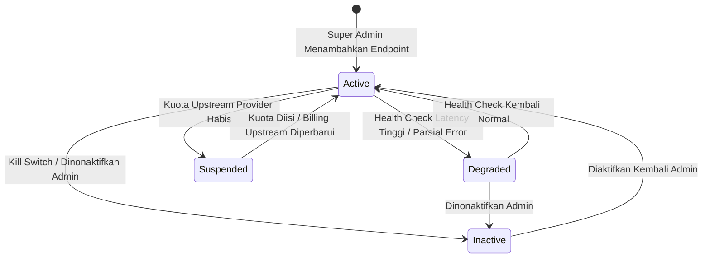

# Manajemen Endpoint Pool & Kredensial Provider

Dokumen ini mendefinisikan desain teknis tabel `ai_endpoints`, mekanisme pengelompokan pool, seleksi beban (load balancing), dan manajemen status kesehatan.

---

## 1. Skema Database `ai_endpoints`

Tabel `ai_endpoints` mencatat seluruh koneksi upstream ke AI provider yang dikendalikan oleh sistem secara terpusat.

```sql
CREATE TABLE IF NOT EXISTS ai_endpoints (
    id UUID PRIMARY KEY DEFAULT gen_random_uuid(),
    name VARCHAR(100) NOT NULL UNIQUE,
    base_url TEXT NOT NULL,
    api_key_encrypted BYTEA NOT NULL,
    provider VARCHAR(50) NOT NULL,
    priority INT NOT NULL DEFAULT 1,
    status VARCHAR(20) NOT NULL DEFAULT 'active',
    health VARCHAR(20) NOT NULL DEFAULT 'healthy',
    last_check_at TIMESTAMPTZ,
    modalities TEXT[] NOT NULL DEFAULT '{"chat","vision","voice","embedding","reasoning"}',
    weight INT NOT NULL DEFAULT 100,
    created_at TIMESTAMPTZ NOT NULL DEFAULT NOW(),
    updated_at TIMESTAMPTZ NOT NULL DEFAULT NOW(),
    CONSTRAINT chk_endpoint_status CHECK (status IN ('active', 'degraded', 'inactive', 'suspended')),
    CONSTRAINT chk_endpoint_health CHECK (health IN ('healthy', 'unhealthy', 'unknown'))
);

CREATE INDEX idx_ai_endpoints_status_priority ON ai_endpoints(status, priority);
```

### Penjelasan Kolom:
- `name`: Nama unik deskriptif (contoh: `9router-local-primary`, `openai-cloud-fallback`).
- `base_url`: Alamat URL OpenAI-compatible upstream (contoh: `http://localhost:20128/v1` atau `https://api.openai.com/v1`).
- `api_key_encrypted`: Kunci API terenkripsi menggunakan AES-256-GCM.
- `provider`: Kode provider upstream (`9router`, `openai`, `gemini`, `groq`, `anthropic`).
- `priority`: Nilai prioritas urutan eksekusi. Angka terkecil (1) dieksekusi pertama kali.
- `status`: Kontrol administratif (Kill Switch). `active` = normal, `inactive` = dimatikan oleh admin.
- `health`: Status operasional otomatis dari circuit breaker dan health checker.
- `modalities`: Kategori kemampuan fitur yang didukung oleh endpoint ini.
- `weight`: Bobot distribusi trafik (default 100) jika terdapat multiple endpoints dalam tingkat prioritas yang sama.

---

## 2. Seed Data Default

Pada instalasi awal migrasi, sistem mengonfigurasi 9router lokal sebagai endpoint utama, dengan fallback ke direct provider:

| Name | Base URL | Provider | Priority | Modalities | Status |
|---|---|---|---|---|---|
| `9router-local-primary` | `http://localhost:20128/v1` | `9router` | 1 | chat, vision, voice, embedding, reasoning | `active` |
| `openai-direct-fallback` | `https://api.openai.com/v1` | `openai` | 2 | chat, vision, voice, embedding | `active` |
| `groq-speed-fallback` | `https://api.groq.com/openai/v1` | `groq` | 3 | chat, reasoning | `active` |

---

## 3. Manajemen Lifecycle Endpoint



---

## 4. Mekanisme Seleksi Pool (Selection Algorithm)

Ketika sebuah request memerlukan endpoint:
1. **Filter Kandidat**:
   - `status == 'active'`
   - `health != 'unhealthy'` (kecuali jika endpoint berada dalam masa probe Half-Open)
   - `use_case` termasuk dalam array `modalities`
2. **Pengurutan Tingkat Prioritas**:
   - Urutkan kandidat berdasarkan `priority ASC`.
3. **Weight Balancing (Bila Priority Sama)**:
   - Jika terdapat 2 atau lebih endpoint dengan nilai `priority` yang identik (contoh: dua endpoint lokal di port berbeda), lakukan Weighted Round-Robin atau Random Selection berbobot sesuai nilai `weight`.
4. **Fallback Chaining**:
   - Gateway membungkus daftar endpoint terpilih ke dalam `ExecutionChain`. Jika endpoint pertama gagal memenuhi kontrak atau memicu circuit breaker, eksekutor melanjutkan ke index berikutnya pada rantai.

---

## 5. Active & Passive Health Checker

### 5.1. Passive Health Monitoring (Inline)
- Setiap kali request normal selesai diproses, HTTP transport client mengukur durasi `latency_ms`.
- Jika request menghasilkan response HTTP 200, metrik keberhasilan dicatat.
- Jika request menghasilkan HTTP 502/503/504 atau timeout, failure counter dinaikkan seketika tanpa menunggu siklus cron.

### 5.2. Active Health Checker (Background Worker)
Background worker berjalan di background runtime Go:
- **Interval**: 60 detik.
- **Probe Request**: Mengirimkan HTTP request ringan `GET /models` atau `POST /embeddings` dengan string 1 kata ("ping").
- **Timeout**: 5 detik.
- **Transisi Status**:
  - Jika probe sukses dan status sebelumnya `unhealthy`, ubah status menjadi `healthy` dan reset failure counters.
  - Jika probe gagal berturut-turut 2 kali, tandai `health = 'unhealthy'`.
  - Catat timestamp pada kolom `last_check_at`.
