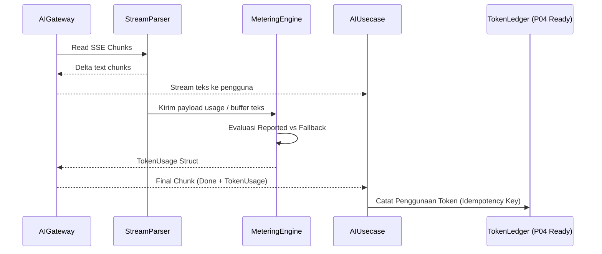

# Metering Token & Heuristic Fallback Estimator

Dokumen ini mendefinisikan mekanisme pengukuran konsumsi token AI (chat, vision, voice, embedding), format pelaporan, serta algoritma fallback heuristik saat upstream provider tidak mengembalikan data usage.

---

## 1. Tujuan & Kontrak Data

Metering token merupakan prasyarat mutlak untuk Fase P04 (Billing & Token Ledger). Setiap interaksi AI wajib menghasilkan struct penggunaan token yang deterministik:

```go
type TokenUsage struct {
    PromptTokens     int    `json:"prompt_tokens"`
    CompletionTokens int    `json:"completion_tokens"`
    TotalTokens      int    `json:"total_tokens"`
    Source           string `json:"source"` // "provider_reported" | "heuristic_estimated"
    Model            string `json:"model"`
    UseCase          string `json:"use_case"`
}
```

---

## 2. Sumber Data Utama: Provider Reported Usage

Pada respons standar OpenAI-compatible:
1. **Untuk Non-Streaming (`/chat/completions`, `/embeddings`)**:
   Payload JSON memuat field `usage` pada root level:
   ```json
   {
     "id": "chatcmpl-123",
     "choices": [...],
     "usage": {
       "prompt_tokens": 156,
       "completion_tokens": 42,
       "total_tokens": 198
     }
   }
   ```
   Gateway langsung mem-parsing integer tersebut dan memberi label `Source = "provider_reported"`.

2. **Untuk Streaming SSE**:
   Ketika client meminta stream (`stream: true`), gateway menyertakan opsi:
   `"stream_options": {"include_usage": true}`.
   Pada chunk SSE terakhir sebelum `[DONE]`, upstream mengirimkan payload:
   ```json
   data: {"choices":[],"usage":{"prompt_tokens":156,"completion_tokens":42,"total_tokens":198}}
   ```
   Streaming parser di `internal/aigateway/client` menangkap chunk ini dan mengekstrak metrik final.

---

## 3. Sumber Data Fallback: Heuristic Estimator

### 3.1. Kapan Fallback Diaktifkan?
Heuristic estimator otomatis aktif jika:
- Upstream tidak mendukung `stream_options.include_usage`.
- Koneksi stream terputus di tengah jalan sebelum chunk usage tiba.
- Provider mengembalikan field `usage` bernilai `0` atau `null`.

### 3.2. Algoritma Estimasi Teks (Bahasa Indonesia & Latin)
Berdasarkan karakteristik tokenizer BPE (Byte Pair Encoding) pada model LLM modern (GPT-4o, Llama 3, Qwen):
- Rata-rata 1 kata bahasa Indonesia setara dengan 1.3 - 1.5 token karena afiksasi/imbuhan kata.
- Secara umum, 1 token berkisar antara 3.5 hingga 4 karakter teks latin.

#### Formula Estimator:
```go
package metering

import (
	"math"
	"strings"
)

// EstimateTextTokens menghitung perkiraan jumlah token dari string teks
func EstimateTextTokens(text string) int {
	cleanText := strings.TrimSpace(text)
	if cleanText == "" {
		return 0
	}

	charCount := float64(len([]rune(cleanText)))
	
	// Rasio rata-rata 1 token ≈ 3.8 karakter + safety buffer 10%
	estimated := math.Ceil((charCount / 3.8) * 1.1)
	
	if estimated < 1 {
		return 1
	}
	return int(estimated)
}
```

---

## 4. Estimasi Modality Khusus (Vision & Voice)

### 4.1. Modality Vision (Gambar Bukti Transaksi)
- **High Resolution Grid**: Menghitung tile 512x512 piksel dari gambar struk yang dikirim.
- **Biaya Dasar (Base Tokens)**: Setiap gambar bernilai minimum 85 token (low-detail) atau 170 token per tile 512x512 (high-detail).
- Jika provider tidak mengembalikan detail prompt tokens untuk vision, gateway menetapkan default flat:
  `PromptTokens = 300` per gambar struk standar.

### 4.2. Modality Voice (Audio Transcription)
- Menggunakan durasi audio dalam detik.
- Rata-rata transkripsi bicara: 1 detik audio menghasilkan ~2.5 kata (~3.5 token output).
- Jika durasi audio adalah $T$ detik:
  `PromptTokens = int(math.Ceil(float64(durationSeconds) * 2.0))`
  `CompletionTokens = EstimateTextTokens(transcribedText)`

---

## 5. Alur Propagasi ke Business Logic



Dengan standarisasi ini, seluruh layer AI di FinTrack v2 menghasilkan pencatatan token yang transparan, adil, dan siap didebit oleh modul Billing di Fase P04.
