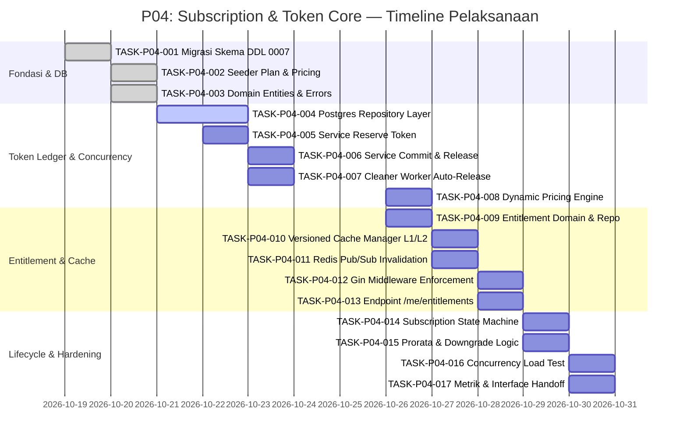

# Timeline & Dependensi — P04: Subscription & Token Core

## Garis Waktu Eksekusi (Timeline)

Sprint P04 direncanakan berlangsung selama 10 hari kerja (2 pekan kalender), dimulai pada tanggal 19 Oktober 2026 hingga 30 Oktober 2026.



---

## Analisis Jalur Kritis (Critical Path Analysis)

Jalur kritis proyek menentukan durasi minimum penyelesaian sprint:

$$\text{TASK-001} \longrightarrow \text{TASK-004} \longrightarrow \text{TASK-005} \longrightarrow \text{TASK-006} \longrightarrow \text{TASK-010} \longrightarrow \text{TASK-012} \longrightarrow \text{TASK-016}$$

- **Titik Kritis 1:** Transaksi `SELECT ... FOR UPDATE` pada PostgreSQL (TASK-P04-004). Kualitas isolasi dan performa query di titik ini menentukan stabilitas seluruh alur reservasi token di downstream.
- **Titik Kritis 2:** Pola 2-Phase Ledger (TASK-P04-005 & TASK-P04-006). Keterlambatan pada desain ini akan memblokir integrasi dengan AI Gateway (P03) dan pengujian anti-double-spending (TASK-P04-016).
- **Titik Kritis 3:** Versioned Cache & Redis Pub/Sub (TASK-P04-010 & TASK-P04-011). Memastikan invalidasi seketika tanpa downtime dan tanpa membebani database utama saat volume request tinggi.

---

## Peta Dependensi Antar Fase

```
┌─────────────────────────────────┐      ┌─────────────────────────────────┐
│     P02: Fondasi Platform       │      │     P03: AI Gateway Terpusat    │
│  - Redis Cache & Pub/Sub        │      │  - Proxy & Token Counter        │
│  - Feature Flag Engine          │      │  - Multi-modality Routes        │
└────────────────┬────────────────┘      └────────────────┬────────────────┘
                 │                                        │
                 ▼                                        ▼
┌──────────────────────────────────────────────────────────────────────────┐
│                 P04: Subscription & Token Core (Fase Ini)                │
│  - Skema Tabel Plans, Subscriptions, Ledger, Pricing Rules               │
│  - Transaksional 2-Phase Token Ledger (Reserve-Commit-Release)           │
│  - Dynamic Pricing Engine (Integer IDR)                                  │
│  - Entitlement Resolver & Middleware Guard (RequireFeature, WithinLimit) │
│  - Versioned Multi-Level Cache (L1/L2) + Redis Invalidation              │
└────────────────┬────────────────────────────────────────┬────────────────┘
                 │                                        │
                 ▼                                        ▼
┌─────────────────────────────────┐      ┌─────────────────────────────────┐
│     P05: Payments & Billing     │      │   P06: Super Admin Dashboard    │
│  - Payment Gateway Integration  │      │  - Plan & Pricing CRUD          │
│  - Midtrans Webhook Receiver    │      │  - Subscription Monitoring      │
│  - Prorated Invoicing           │      │  - Token Ledger Audit Viewer    │
└─────────────────────────────────┘      └─────────────────────────────────┘
```

### 1. Dependensi Masukan (Upstream Dependencies)
- **Dari P02 (Fondasi Platform):**
  - Ketersediaan instance Redis 7+ pada `docker-compose.yml` untuk L2 cache dan Pub/Sub.
  - Modul audit logger dasar (`internal/audit/`) untuk mencatat mutasi administratif.
  - Feature flag evaluator untuk menyalakan/mematikan penegakan kuota secara bertahap.
- **Dari P03 (AI Gateway Terpusat):**
  - Interface metering token aktual (`actual_prompt_tokens`, `actual_completion_tokens`) yang dikembalikan oleh AI Gateway pasca-eksekusi model.
  - Penanda jenis modalitas (`chat`, `vision`, `voice`, `embedding`) pada metadata pemanggilan.

### 2. Ketergantungan Keluaran (Downstream Handoff)
- **Ke P05 (Payments & Billing):**
  - Model data `subscriptions` yang siap diperbarui statusnya saat webhook pembayaran diterima (`active`, `past_due`, `canceled`).
  - Fungsi `CalculateUpgradeProration` untuk menghitung nominal tagihan invoice saat user melakukan upgrade.
  - Kontrak interface billing service untuk aktivasi dan perpanjangan periode.
- **Ke P06 (Super Admin Dashboard):**
  - Repository dan query builder untuk menampilkan daftar `plans`, riwayat transaksi `token_ledger`, dan event audit `subscription_events` pada tabel TanStack Table v8.
  - Handler API untuk pembaruan parameter harga dinamis pada tabel `pricing_rules`.
