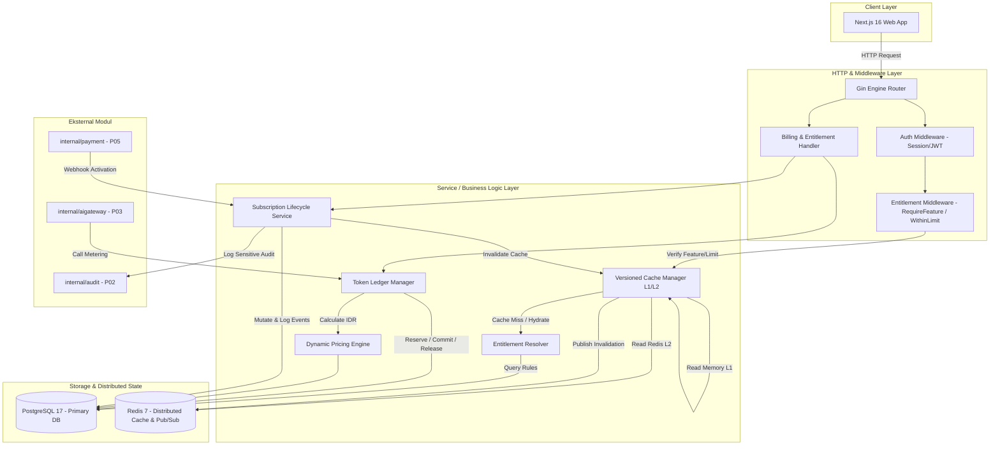

# Arsitektur Billing & Entitlement — FinTrack v2

Dokumen ini menjelaskan rancangan arsitektur tingkat tinggi (*high-level architecture*) untuk modul `internal/billing/` dan `internal/entitlement/` pada FinTrack v2. Sistem ini dirancang untuk melayani model B2C (per-user, tanpa multi-tenancy `tenant_id`), penegakan hak akses real-time, pencatatan mutasi token append-only, dan penetapan harga dinamis berbasis mata uang Rupiah bulat (`BIGINT`).

---

## 1. Diagram Komponen Sistem



---

## 2. Struktur Modul & Clean Architecture

Struktur paket diorganisasikan secara modular untuk memastikan batas tanggung jawab (*separation of concerns*) yang tegas:

```
internal/
├── billing/
│   ├── domain/
│   │   ├── plan.go                # Entity Plan, PlanEntitlement, PlanLimit
│   │   ├── subscription.go        # Entity Subscription, SubscriptionEvent, Status Enum
│   │   ├── token.go               # Entity TokenPeriod, TokenLedgerEntry, LedgerType Enum
│   │   ├── pricing.go             # Entity PricingRule, Modality Multipliers
│   │   └── errors.go              # Domain Error definitions
│   ├── repository/
│   │   ├── postgres_plan.go       # SQL CRUD Plan & Entitlements
│   │   ├── postgres_subscription.go # SQL Subscription state mutations
│   │   ├── postgres_ledger.go     # SQL Row-locking SELECT ... FOR UPDATE & Append Ledger
│   │   └── postgres_pricing.go    # SQL Pricing rules loader
│   ├── service/
│   │   ├── subscription_service.go# Lifecycle state machine, Proration, Soft-limit
│   │   ├── ledger_service.go      # 2-Phase Reserve-Commit-Release logic
│   │   ├── pricing_service.go     # Dynamic Pricing Calculator
│   │   └── cleaner_worker.go      # Periodic auto-release background cleaner
│   └── handler/
│       ├── billing_handler.go     # Public & User Subscription HTTP Endpoints
│       └── dto.go                 # Request/Response DTO structs
│
└── entitlement/
    ├── domain/
    │   ├── feature.go             # Feature keys constants & boolean checks
    │   ├── limit.go               # Limit keys constants & evaluation rules
    │   └── user_entitlement.go    # Aggregated user capabilities struct
    ├── repository/
    │   └── resolver_repo.go       # DB aggregator for user plan + limits
    ├── cache/
    │   ├── versioned_cache.go     # Multi-level L1 (In-Memory) + L2 (Redis) manager
    │   └── pubsub_subscriber.go   # Redis pub/sub listener for cross-instance invalidation
    ├── service/
    │   └── entitlement_service.go # Public service interface for guards
    └── middleware/
        ├── require_feature.go     # Gin middleware: Boolean feature gate
        └── within_limit.go        # Gin middleware: Numeric quota gate
```

---

## 3. Skema Basis Data Relasional (PostgreSQL 17)

Seluruh tabel disimpan di dalam database PostgreSQL 17 dengan skema DDL yang dioptimalkan untuk integritas referensial dan latensi kueri rendah:

### 3.1. Tabel `plans`
Menyimpan definisi paket langganan.
```sql
CREATE TABLE plans (
    id UUID PRIMARY KEY DEFAULT gen_random_uuid(),
    code VARCHAR(32) NOT NULL UNIQUE, -- 'free', 'pro', 'business'
    name VARCHAR(64) NOT NULL,
    description TEXT,
    price_monthly_idr BIGINT NOT NULL DEFAULT 0, -- Nilai integer Rupiah
    price_yearly_idr BIGINT NOT NULL DEFAULT 0,  -- Nilai integer Rupiah
    is_active BOOLEAN NOT NULL DEFAULT TRUE,
    is_public BOOLEAN NOT NULL DEFAULT TRUE,
    fallback_gateway VARCHAR(32) NOT NULL DEFAULT 'midtrans',
    sort_order INT NOT NULL DEFAULT 0,
    created_at TIMESTAMPTZ NOT NULL DEFAULT CURRENT_TIMESTAMP,
    updated_at TIMESTAMPTZ NOT NULL DEFAULT CURRENT_TIMESTAMP
);
```

### 3.2. Tabel `plan_entitlements`
Menyimpan saklar fitur boolean untuk setiap paket.
```sql
CREATE TABLE plan_entitlements (
    id UUID PRIMARY KEY DEFAULT gen_random_uuid(),
    plan_id UUID NOT NULL REFERENCES plans(id) ON DELETE CASCADE,
    feature_key VARCHAR(64) NOT NULL, -- 'ai_chat', 'export_csv', 'ocr_receipt', dll
    is_enabled BOOLEAN NOT NULL DEFAULT FALSE,
    created_at TIMESTAMPTZ NOT NULL DEFAULT CURRENT_TIMESTAMP,
    updated_at TIMESTAMPTZ NOT NULL DEFAULT CURRENT_TIMESTAMP,
    CONSTRAINT uq_plan_feature UNIQUE (plan_id, feature_key)
);
```

### 3.3. Tabel `plan_limits`
Menyimpan batasan kuota numerik per paket.
```sql
CREATE TABLE plan_limits (
    id UUID PRIMARY KEY DEFAULT gen_random_uuid(),
    plan_id UUID NOT NULL REFERENCES plans(id) ON DELETE CASCADE,
    limit_key VARCHAR(64) NOT NULL, -- 'daily_ai_tokens', 'max_wallets', dll
    limit_value BIGINT NOT NULL,     -- -1 merepresentasikan unlimited
    created_at TIMESTAMPTZ NOT NULL DEFAULT CURRENT_TIMESTAMP,
    updated_at TIMESTAMPTZ NOT NULL DEFAULT CURRENT_TIMESTAMP,
    CONSTRAINT uq_plan_limit UNIQUE (plan_id, limit_key)
);
```

### 3.4. Tabel `subscriptions`
Menyimpan status dan periode langganan aktif pengguna.
```sql
CREATE TABLE subscriptions (
    id UUID PRIMARY KEY DEFAULT gen_random_uuid(),
    user_id UUID NOT NULL REFERENCES users(id) ON DELETE RESTRICT,
    plan_id UUID NOT NULL REFERENCES plans(id) ON DELETE RESTRICT,
    status VARCHAR(32) NOT NULL DEFAULT 'active', -- 'trialing', 'active', 'past_due', 'grace', 'canceled', 'expired'
    current_period_start TIMESTAMPTZ NOT NULL,
    current_period_end TIMESTAMPTZ, -- NULL untuk paket 'free' permanen
    cancel_at_period_end BOOLEAN NOT NULL DEFAULT FALSE,
    canceled_at TIMESTAMPTZ,
    gateway VARCHAR(32) NOT NULL DEFAULT 'manual', -- 'midtrans', 'xendit', 'manual'
    gateway_subscription_id VARCHAR(128),
    metadata JSONB NOT NULL DEFAULT '{}'::jsonb,
    created_at TIMESTAMPTZ NOT NULL DEFAULT CURRENT_TIMESTAMP,
    updated_at TIMESTAMPTZ NOT NULL DEFAULT CURRENT_TIMESTAMP,
    CONSTRAINT uq_user_subscription UNIQUE (user_id)
);

CREATE INDEX idx_subscriptions_status_period ON subscriptions (status, current_period_end);
```

### 3.5. Tabel `subscription_events`
Audit log append-only untuk melacak seluruh transisi status dan pembaruan paket.
```sql
CREATE TABLE subscription_events (
    id UUID PRIMARY KEY DEFAULT gen_random_uuid(),
    subscription_id UUID NOT NULL REFERENCES subscriptions(id) ON DELETE CASCADE,
    user_id UUID NOT NULL REFERENCES users(id) ON DELETE RESTRICT,
    event_type VARCHAR(64) NOT NULL, -- 'created', 'renewed', 'upgraded', 'downgraded', 'past_due', 'canceled', 'expired'
    previous_state JSONB NOT NULL,
    new_state JSONB NOT NULL,
    reason TEXT,
    actor_id UUID REFERENCES users(id) ON DELETE SET NULL, -- NULL jika sistem otomatis
    ip_address VARCHAR(45),
    user_agent TEXT,
    created_at TIMESTAMPTZ NOT NULL DEFAULT CURRENT_TIMESTAMP
);

CREATE INDEX idx_sub_events_user ON subscription_events (user_id, created_at DESC);
```

### 3.6. Tabel `token_periods`
Melacak alokasi dan pemakaian kuota token harian per user (TZ Asia/Jakarta).
```sql
CREATE TABLE token_periods (
    id UUID PRIMARY KEY DEFAULT gen_random_uuid(),
    user_id UUID NOT NULL REFERENCES users(id) ON DELETE RESTRICT,
    period_start TIMESTAMPTZ NOT NULL,
    period_end TIMESTAMPTZ NOT NULL,
    daily_quota BIGINT NOT NULL,      -- Batas kuota total hari tersebut
    used_tokens BIGINT NOT NULL DEFAULT 0,     -- Token aktual yang telah dikonsumsi (commit)
    reserved_tokens BIGINT NOT NULL DEFAULT 0, -- Token yang sedang dikunci sementara (in-flight)
    created_at TIMESTAMPTZ NOT NULL DEFAULT CURRENT_TIMESTAMP,
    updated_at TIMESTAMPTZ NOT NULL DEFAULT CURRENT_TIMESTAMP,
    CONSTRAINT uq_user_token_period UNIQUE (user_id, period_start),
    CONSTRAINT chk_token_balance CHECK (used_tokens >= 0 AND reserved_tokens >= 0)
);

CREATE INDEX idx_token_periods_user_window ON token_periods (user_id, period_start, period_end);
```

### 3.7. Tabel `token_ledger`
Buku besar mutasi token append-only dengan idempotency key.
```sql
CREATE TABLE token_ledger (
    id UUID PRIMARY KEY DEFAULT gen_random_uuid(),
    period_id UUID NOT NULL REFERENCES token_periods(id) ON DELETE RESTRICT,
    user_id UUID NOT NULL REFERENCES users(id) ON DELETE RESTRICT,
    reservation_id UUID, -- NULL jika mutasi tipe 'grant' atau 'adjust'
    entry_type VARCHAR(32) NOT NULL, -- 'reserve', 'commit', 'release', 'grant', 'adjust'
    amount BIGINT NOT NULL,           -- Jumlah token (+ untuk pemakaian/reserve, - untuk release)
    modality VARCHAR(32) NOT NULL DEFAULT 'chat', -- 'chat', 'vision', 'voice', 'embedding', 'system'
    cost_idr BIGINT NOT NULL DEFAULT 0,           -- Nilai estimasi biaya Rupiah bulat
    idempotency_key VARCHAR(64) NOT NULL UNIQUE,
    reference_id VARCHAR(128),                    -- ID Chat / Request Trace ID
    notes TEXT,
    created_at TIMESTAMPTZ NOT NULL DEFAULT CURRENT_TIMESTAMP
);

CREATE INDEX idx_token_ledger_user ON token_ledger (user_id, created_at DESC);
CREATE INDEX idx_token_ledger_reservation ON token_ledger (reservation_id) WHERE reservation_id IS NOT NULL;
```

### 3.8. Tabel `pricing_rules`
Pengaturan penetapan harga dinamis untuk konversi kuota dan kalkulasi margin.
```sql
CREATE TABLE pricing_rules (
    id UUID PRIMARY KEY DEFAULT gen_random_uuid(),
    rule_name VARCHAR(64) NOT NULL UNIQUE,
    base_per_1k_idr BIGINT NOT NULL DEFAULT 300, -- Rp 300 per 1.000 token dasar
    markup_multiplier NUMERIC(6, 4) NOT NULL DEFAULT 1.2500, -- Pengali 1.25x (margin 25%)
    markup_percent INT NOT NULL DEFAULT 0,                   -- Tambahan persentase
    modality_multipliers JSONB NOT NULL DEFAULT '{
        "chat": 1.0,
        "vision": 2.5,
        "voice": 3.0,
        "embedding": 0.5,
        "reasoning": 2.0
    }'::jsonb,
    is_active BOOLEAN NOT NULL DEFAULT TRUE,
    created_at TIMESTAMPTZ NOT NULL DEFAULT CURRENT_TIMESTAMP,
    updated_at TIMESTAMPTZ NOT NULL DEFAULT CURRENT_TIMESTAMP
);
```

---

## 4. Pola Interaksi Modul (Integration Flow)

### 4.1. Alur Penegakan Fitur & Entitlement Check
1. Klien mengirim permintaan HTTP `POST /api/v1/ocr/receipt`.
2. `AuthMiddleware` memvalidasi cookie sesi / JWT dan menaruh entitas `UserContext` ke dalam gin context.
3. `RequireFeature("ocr_receipt")` memeriksa cache versi pengguna di memory L1.
4. Jika cache hit dan bernilai `true`: Request diteruskan langsung ke handler (< 1ms).
5. Jika cache miss:
   - Ambil counter versi `entitlement:ver:{user_id}` dari Redis.
   - Ambil data agregat dari PostgreSQL jika key `entitlement:u:{uid}:v:{ver}` tidak ditemukan di Redis L2.
   - Simpan hasil di Redis (TTL 24 jam) dan L1 memory (TTL 60 detik).
6. Jika `is_enabled == false`: Kembalikan HTTP `403 Forbidden` dengan informasi paket yang mendukung fitur tersebut.

### 4.2. Alur Pemotongan Kuota Token AI
1. Klien mengirim pesan obrolan AI `POST /api/v1/ai/chat`.
2. Endpoint memanggil `LedgerService.ReserveToken(ctx, userID, estTokens, idempotencyKey)`.
3. `LedgerService` membuka transaksi DB singkat:
   - Mengambil row `token_periods` pengguna hari ini dengan `SELECT ... FOR UPDATE`.
   - Memastikan `used_tokens + reserved_tokens + estTokens <= daily_quota`.
   - Mengupdate `reserved_tokens = reserved_tokens + estTokens`.
   - Memasukkan entri `token_ledger` bertipe `reserve`.
   - Commit transaksi DB (lock baris dilepas).
4. Request diteruskan ke `internal/aigateway` untuk eksekusi streaming ke LLM.
5. Saat respons selesai, AI Gateway mengembalikan metadata konsumsi riil (`actualTokens`).
6. Endpoint memanggil `LedgerService.CommitToken(ctx, userID, reservationID, actualTokens)` dalam transaksi terpisah yang singkat:
   - Menyesuaikan `reserved_tokens = reserved_tokens - estTokens` dan `used_tokens = used_tokens + actualTokens`.
   - Memasukkan entri `token_ledger` bertipe `commit`.
7. Jika AI Gateway error di tengah jalan, dipanggil `LedgerService.ReleaseToken(ctx, userID, reservationID)` untuk mengembalikan alokasi yang terkunci.
