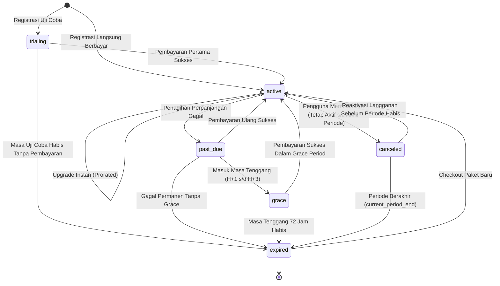

# Siklus Hidup Langganan (Subscription Lifecycle) — FinTrack v2

Dokumen ini mendokumentasikan mesin keadaan (*state machine*), aturan transisi, audit event, dan kebijakan penyesuaian paket (upgrade prorata instan dan downgrade berjadwal soft-limit) pada modul `internal/billing/service/subscription_service.go`.

---

## 1. Diagram State Machine Langganan



---

## 2. Definisi Status Langganan (`status`)

| Kode Status | Deskripsi Operasional | Hak Akses Fitur | Kuota Token AI | Catatan UX / Banner |
|---|---|:---:|:---:|---|
| `trialing` | Pengguna dalam periode promosi uji coba gratis Pro/Business. | Sesuai Paket Trial | Sesuai Paket Trial | Banner hitung mundur sisa hari masa trial. |
| `active` | Langganan aktif dan terbayar penuh. | Penuh Sesuai Paket | Normal Harian | Status normal tanpa peringatan. |
| `past_due` | Upaya perpanjangan otomatis/manual gagal pada tanggal jatuh tempo. | Penuh Sesuai Paket | Normal Harian | Banner peringatan: Penagihan gagal, silakan perbarui metode pembayaran. |
| `grace` | Masa tenggang (72 jam) setelah status `past_due`. | Penuh Sesuai Paket | Normal Harian | Banner kritis merah: Langganan akan diturunkan dalam X jam jika belum dibayar. |
| `canceled` | Pengguna meminta berhenti berlangganan, namun masa aktif masih ada. | Penuh hingga `current_period_end` | Normal hingga akhir periode | Penanda: Paket berakhir pada tanggal `current_period_end`, opsi reaktivasi tersedia. |
| `expired` | Langganan habis total; akun diturunkan ke paket default `free`. | Paket Free Saja | Kuota Free (10.000) | Penawaran upgrade kembali ke paket Pro. |

---

## 3. Matriks Transisi Keadaan (State Transitions)

Setiap transisi status diverifikasi melalui fungsi validator untuk mencegah lonjakan state yang tidak sah:

| State Awal | Event Pemicu | State Tujuan | Aksi Sampingan (Side-Effects) |
|---|---|---|---|
| `*` | `CHECKOUT_SUCCESS` | `active` | Set `current_period_start` = NOW(), hitung `current_period_end`, buat entri `token_periods`, invalidate entitlement cache. |
| `active` | `RENEWAL_SUCCESS` | `active` | Perpanjang `current_period_end` (+30 hari / +365 hari), catat `subscription_events`. |
| `active` | `UPGRADE_REQUEST` | `active` | Hitung kredit prorata, tagihkan selisih harga, perbarui `plan_id` seketika, invalidate cache, naikkan kuota token hari berjalan. |
| `active` | `RENEWAL_FAILED` | `past_due` | Jadwalkan notifikasi peringatan H-0, mulai timer retry dunning. |
| `active` | `USER_CANCEL` | `canceled` | Tandai `cancel_at_period_end = true`, catat `canceled_at = NOW()`. |
| `past_due` | `ENTER_GRACE` | `grace` | Mulai hitung mundur 72 jam, kirim email darurat pembayaran. |
| `past_due` / `grace`| `PAYMENT_RETRY_OK` | `active` | Reset status ke normal, perpanjang periode, hapus banner darurat. |
| `grace` / `canceled`| `PERIOD_ENDED` | `expired` | Ubah paket efektif ke `free`, jalankan soft-limit enforcement, invalidate entitlement cache. |
| `canceled` | `USER_REACTIVATE` | `active` | Hapus bendera `cancel_at_period_end = false`, batalkan pemutusan paket. |

---

## 4. Pencatatan Audit Append-Only (`subscription_events`)

Setiap kali status langganan berubah, baris baru dimasukkan ke tabel `subscription_events`:

```sql
INSERT INTO subscription_events (
    subscription_id, user_id, event_type, 
    previous_state, new_state, reason, 
    actor_id, ip_address, user_agent
) VALUES (
    'a1b2c3d4-...', 'u1v2w3-...', 'upgraded',
    '{"plan_id": "free", "status": "active"}'::jsonb,
    '{"plan_id": "pro", "status": "active", "prorated_credit_idr": 0}'::jsonb,
    'Pengguna melakukan upgrade via Midtrans Snap',
    'u1v2w3-...', '103.20.18.5', 'Mozilla/5.0...'
);
```

Tabel ini memberikan jaminan *non-repudiation* untuk memecahkan sengketa penagihan pengguna atau audit kepatuhan UU PDP No. 27/2022.

---

## 5. Kebijakan Upgrade Instan Prorata (Instant Proration)

Ketika pengguna paket berbayar berpindah ke paket yang lebih tinggi di pertengahan siklus:
1. **Perhitungan Hari Tersisa:**
   Sisa durasi dihitung secara presisi berdasarkan hari kalender (TZ Asia/Jakarta):
   $$\text{Days Remaining} = \max\left(0, \left\lfloor \frac{\text{current\_period\_end} - \text{NOW()}}{86400} \right\rfloor \right)$$
2. **Kalkulasi Kredit Prorata (Paket Lama):**
   $$\text{Credit}_{\text{IDR}} = \left\lfloor \frac{\text{Days Remaining}}{\text{Total Days In Period}} \times \text{Old Plan Price}_{\text{IDR}} \right\rfloor$$
3. **Kalkulasi Biaya Bersih Upgrade:**
   $$\text{Net Upgrade Cost}_{\text{IDR}} = \max\left(0, \text{New Plan Price}_{\text{IDR}} - \text{Credit}_{\text{IDR}}\right)$$
4. **Eksekusi:**
   - Setelah tagihan bersih terbayar, `plan_id` langsung diperbarui ke paket baru.
   - Sisa kuota siklus pada `token_periods` periode berjalan langsung disesuaikan ke kuota paket baru.
   - Cache entitlement diinvalidasi seketika sehingga pengguna langsung menikmati fitur baru tanpa menunggu periode berikutnya.

---

## 6. Kebijakan Downgrade Berjadwal & Soft-Limit (K-09, K-P04-09)

Ketika pengguna memilih untuk menurunkan paket (misal: Business ke Pro, atau Pro ke Free):
1. **Berlaku Akhir Siklus (Scheduled Downgrade):**
   - Penurunan paket **TIDAK DILAKUKAN SEKETIKA**.
   - Sistem menetapkan `cancel_at_period_end = true` dan menyimpan rencana paket baru di kolom `metadata.scheduled_downgrade_plan_id`.
   - Pengguna tetap mendapatkan seluruh hak akses paket saat ini hingga `current_period_end` tercapai.
   - Tidak ada pengembalian uang (*no refund*) untuk sisa hari yang berjalan.
2. **Penegakan Soft-Limit Saat Expired:**
   - Ketika tanggal `current_period_end` tercapai, sistem menurunkan `plan_id` ke paket baru (atau Free).
   - **Data Pengguna Tidak Pernah Dihapus:** Transaksi lama, dompet lama, dan kategori lama tetap utuh di basis data.
   - **Pembatasan Pembuatan Data Baru:** Jika pengguna paket Free memiliki 5 dompet aktif (melebihi limit Free: 2 dompet), pengguna tetap dapat melihat dan mengelola transaksi pada ke-5 dompet tersebut. Namun, saat mencoba menambah dompet ke-6, middleware `WithinLimit` akan memblokir request dan menyarankan upgrade.
