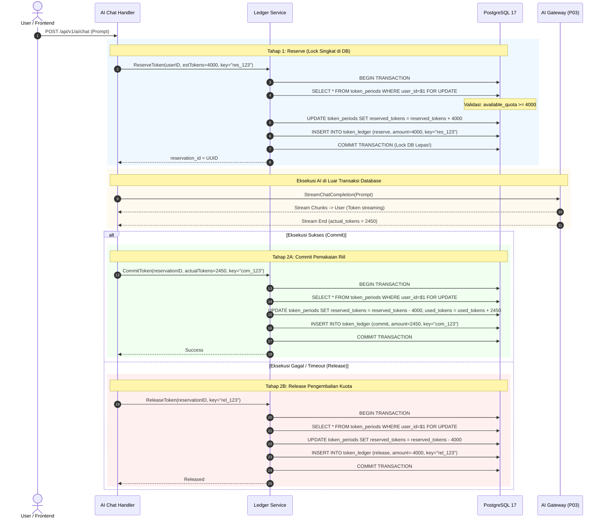

# Token Ledger Engine — FinTrack v2

Dokumen ini mendokumentasikan spesifikasi teknis dan implementasi buku besar token (*Token Ledger*) pada FinTrack v2. Sistem ini dirancang untuk mencatat setiap pergerakan kuota token AI secara transaksional (*ACID*), tahan terhadap kondisi balapan (*race condition*), mencegah pemotongan ganda (*double-spending*), dan sepenuhnya bersifat kekal (*append-only*).

---

## 1. Prinsip Desain Token Ledger (K-03, K-28, K-P04-02, K-P04-03)

1. **Append-Only Immutability:** Tidak ada operasi `UPDATE` atau `DELETE` pada tabel `token_ledger`. Setiap peristiwa (penguncian, pemakaian, pengembalian, pemberian bonus, atau koreksi admin) dicatat sebagai baris mutasi baru.
2. **2-Phase Transactional Mutation:** Konsumsi token AI melibatkan ketidakpastian durasi pemrosesan model LLM. Sistem membagi siklus pemotongan kuota menjadi:
   - Tahap 1: **Reserve** (Kunci kuota maksimal sebelum memanggil AI).
   - Tahap 2: **Commit** (Potong pemakaian aktual setelah streaming AI selesai) ATAU **Release** (Bebaskan kuota jika AI Gateway gagal/timeout).
3. **Pemisahan Lock Database dari Eksekusi Jaringan:** Durasi lock PostgreSQL diminimalkan hingga beberapa milidetik. Koneksi basis data dan lock baris `token_periods` **DILARANG KERAS** ditahan selama request eksternal ke model AI sedang berlangsung.
4. **Idempotensi Total:** Setiap mutasi diverifikasi menggunakan `idempotency_key` unik. Pengiriman ulang request dengan kunci yang sama mengembalikan status sebelumnya tanpa menggandakan mutasi.

---

## 2. Struktur Data & Persamaan Saldo Token

Tabel `token_periods` mengelola ringkasan saldo pengguna untuk rentang hari aktif (Asia/Jakarta):

$$\text{daily\_quota} \ge \text{used\_tokens} + \text{reserved\_tokens}$$

$$\text{available\_quota} = \text{daily\_quota} - (\text{used\_tokens} + \text{reserved\_tokens})$$

### Keterangan Kolom Saldo:
- $\text{daily\_quota}$: Batas kuota total yang dialokasikan paket langganan pengguna untuk hari tersebut.
- $\text{used\_tokens}$: Total token yang telah terkonsumsi secara riil oleh transaksi yang sukses (*committed*).
- $\text{reserved\_tokens}$: Kuota yang sedang dikunci sementara oleh transaksi yang sedang dalam proses eksekusi (*in-flight*).
- $\text{available\_quota}$: Kuota bebas yang masih dapat diajukan untuk reservasi baru.

---

## 3. Jenis Mutasi Ledger (`entry_type`)

| Tipe Mutasi | Simbol | Efek terhadap `reserved_tokens` | Efek terhadap `used_tokens` | Deskripsi |
|---|:---:|:---:|:---:|---|
| `reserve` | `+RES` | `+amount` | Tidak berubah | Mengunci kuota estimasi saat user memulai request AI. |
| `commit` | `+COM` | `-reserved_amount` | `+actual_amount` | Mengurangi kuota terkunci dan menambah token terpakai riil. |
| `release` | `-REL` | `-reserved_amount` | Tidak berubah | Mengembalikan kuota yang terkunci akibat kegagalan AI. |
| `grant` | `+GRN` | Tidak berubah | `-amount` atau tambah kuota | Pemberian kompensasi token ekstra dari super admin. |
| `adjust` | `±ADJ` | Sesuai rekonsiliasi | Sesuai rekonsiliasi | Penyesuaian manual koreksi audit oleh super admin. |
| `refund` | `-REF` | Tidak berubah | `-amount` | Mengembalikan token yang **sudah** ditagih (`used_tokens`) saat fitur gagal setelah `commit` — mis. OCR yang tidak menghasilkan data terpakai. Nilai di-*clamp* ke `used_tokens` sehingga saldo tidak pernah negatif; idempoten via `idempotency_key`. |

> **Reserve adalah estimasi (P3), bukan tagihan.** `reserve` mengunci *estimasi* token
> per modalitas (`settings.ai_estimate_chat|reasoning|vision|voice|embedding`, default
> 2000/4000/5000/2000/1000). Pengguna yang sisa kuotanya tidak cukup untuk estimasi
> ditolak **di depan** (HTTP 429 `insufficient_quota`) tanpa pemotongan apa pun. Biaya
> riil baru ditetapkan saat `commit` (di-*clamp* ke sisa kuota agar `used_tokens` tidak
> pernah melebihi `quota_tokens`).
>
> **Turn tanpa jawaban AI tidak ditagih.** Event terminal chat membawa penanda
> `NoCharge` (kill switch, filter konten, cooldown, error gateway, template sapaan).
> Billing meresponsnya dengan `release`, bukan `commit` — sehingga kegagalan fitur
> tidak pernah mengurangi saldo pengguna.

---

## 4. Alur Transaksi 2-Fase (Sequence Diagram)



---

## 5. Implementasi Go: Concurrency & Lock Handling

Berikut adalah pola implementasi repository PostgreSQL menggunakan transaksi terisolasi:

```go
package repository

import (
    "context"
    "database/sql"
    "errors"
    "fmt"
    "time"
)

var (
    ErrInsufficientQuota   = errors.New("kuota token per siklus tidak mencukupi")
    ErrReservationNotFound = errors.New("reservasi token tidak ditemukan")
)

type PostgresLedgerRepository struct {
    db *sql.DB
}

// ReserveToken mengunci estimasi token secara atomik
func (r *PostgresLedgerRepository) ReserveToken(ctx context.Context, userID string, estTokens int64, idempKey string, refID string, modality string) (string, error) {
    tx, err := r.db.BeginTx(ctx, &sql.TxOptions{Isolation: sql.LevelReadCommitted})
    if err != nil {
        return "", err
    }
    defer tx.Rollback()

    // 1. Lock baris periode hari ini untuk user
    var periodID string
    var quotaTokens, usedTokens, reservedTokens int64
    queryLock := `
        SELECT id, quota_tokens, used_tokens, reserved_tokens 
        FROM token_periods 
        WHERE user_id = $1 AND period_start <= NOW() AND period_end >= NOW()
        FOR UPDATE`
    
    err = tx.QueryRowContext(ctx, queryLock, userID).Scan(&periodID, &quotaTokens, &usedTokens, &reservedTokens)
    if err != nil {
        return "", fmt.Errorf("gagal mengambil token period: %w", err)
    }

    // 2. Evaluasi kecukupan kuota
    if (usedTokens + reservedTokens + estTokens) > quotaTokens {
        return "", ErrInsufficientQuota
    }

    // 3. Update reserved_tokens
    updatePeriod := `
        UPDATE token_periods 
        SET reserved_tokens = reserved_tokens + $1, updated_at = NOW() 
        WHERE id = $2`
    if _, err = tx.ExecContext(ctx, updatePeriod, estTokens, periodID); err != nil {
        return "", err
    }

    // 4. Catat entri ledger
    var reservationID string
    insertLedger := `
        INSERT INTO token_ledger (
            period_id, user_id, reservation_id, entry_type, amount, 
            modality, idempotency_key, reference_id, notes
        ) VALUES (
            $1, $2, gen_random_uuid(), 'reserve', $3, 
            $4, $5, $6, 'Kuotakan token sementara'
        ) RETURNING reservation_id`
    
    err = tx.QueryRowContext(ctx, insertLedger, periodID, userID, estTokens, modality, idempKey, refID).Scan(&reservationID)
    if err != nil {
        return "", fmt.Errorf("gagal mencatat reserve ledger: %w", err)
    }

    // 5. Commit transaksi DB secepatnya
    if err = tx.Commit(); err != nil {
        return "", err
    }

    return reservationID, nil
}
```

---

## 6. Background Cleaner Worker: Auto-Release Timeout

Jika instance backend mengalami *crash*, *out-of-memory*, atau jaringan mati sebelum instruksi `Commit` atau `Release` dieksekusi, nilai `reserved_tokens` akan menggantung.

Untuk mengatasinya, dibuat background cleaner worker:
- **Interval Eksekusi:** Setiap 15 menit.
- **Kondisi Kadaluwarsa:** Transaksi `reserve` yang berumur $> 5$ menit tanpa adanya pasangan `commit` atau `release`.
- **Aksi Cleaner:**
  1. Cari reservasi yang menggantung via query SQL:
     ```sql
     SELECT r.reservation_id, r.user_id, r.period_id, r.amount
     FROM token_ledger r
     WHERE r.entry_type = 'reserve'
       AND r.created_at < NOW() - INTERVAL '5 minutes'
       AND NOT EXISTS (
           SELECT 1 FROM token_ledger c 
           WHERE c.reservation_id = r.reservation_id 
             AND c.entry_type IN ('commit', 'release')
       )
     LIMIT 100;
     ```
  2. Buka transaksi untuk setiap item kedaluwarsa.
  3. Kurangi `reserved_tokens = reserved_tokens - amount`.
  4. Sisipkan baris `token_ledger` baru:
     - `entry_type = 'release'`
     - `amount = -r.amount`
     - `idempotency_key = 'auto_rel_' || r.reservation_id`
     - `notes = 'Auto-released by background cleaner worker'`
  5. Commit transaksi.
