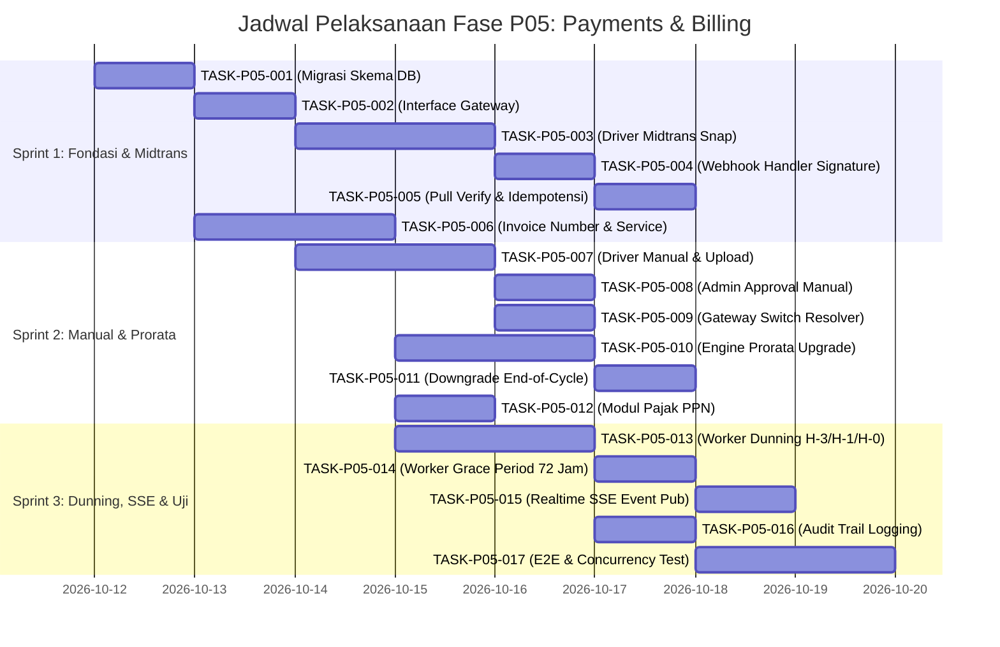

# Timeline & Dependensi — Fase P05 (Payments & Billing)

Dokumen ini memetakan garis waktu eksekusi 15 hari kerja, jalur kritis (*critical path*), dan matriks ketergantungan antar-fase dan antar-tugas pada modul Payments & Billing FinTrack v2.

---

## 1. Jadwal Pelaksanaan (15 Hari Kerja)

---

## 2. Matriks Dependensi Antar-Tugas

| Kode Tugas | Bergantung Pada | Membuka Blokir Untuk | Tingkat Risiko |
|---|---|---|---|
| `TASK-P05-001` | Selesai P02 (User & Fondasi DB) | `TASK-P05-002`, `TASK-P05-006` | Tinggi (Fondasi) |
| `TASK-P05-002` | `TASK-P05-001` | `TASK-P05-003`, `TASK-P05-007` | Sedang |
| `TASK-P05-003` | `TASK-P05-002` | `TASK-P05-004` | Tinggi (Vendor Ext) |
| `TASK-P05-004` | `TASK-P05-003` | `TASK-P05-005` | Tinggi (Keamanan) |
| `TASK-P05-005` | `TASK-P05-004` | `TASK-P05-015`, `TASK-P05-017` | Kritis (Idempotensi) |
| `TASK-P05-006` | `TASK-P05-001` | `TASK-P05-010`, `TASK-P05-012`, `TASK-P05-013` | Sedang |
| `TASK-P05-007` | `TASK-P05-002` | `TASK-P05-008` | Rendah |
| `TASK-P05-008` | `TASK-P05-007` | `TASK-P05-016` | Sedang (Super Admin) |
| `TASK-P05-009` | `TASK-P05-003`, `TASK-P05-007` | `TASK-P05-017` | Sedang |
| `TASK-P05-010` | `TASK-P05-006`, P04 (Subscription) | `TASK-P05-011` | Tinggi (Finansial) |
| `TASK-P05-011` | `TASK-P05-010` | `TASK-P05-017` | Rendah |
| `TASK-P05-012` | `TASK-P05-006` | `TASK-P05-010` | Rendah |
| `TASK-P05-013` | `TASK-P05-006`, P04 | `TASK-P05-014` | Sedang |
| `TASK-P05-014` | `TASK-P05-013` | `TASK-P05-017` | Sedang |
| `TASK-P05-015` | `TASK-P05-005`, P02 (Redis SSE) | `TASK-P05-017` | Sedang |
| `TASK-P05-016` | `TASK-P05-008`, P02 (Audit Skema) | `TASK-P05-017` | Tinggi (Kepatuhan) |
| `TASK-P05-017` | Semua Task Sebelumnya | Rilis Fase P05 & Serah Terima P06 | Kritis (Verifikasi) |

---

## 3. Jalur Kritis (Critical Path)

Jalur kritis proyek fase P05 adalah:
$$\text{TASK-P05-001} \rightarrow \text{TASK-P05-002} \rightarrow \text{TASK-P05-003} \rightarrow \text{TASK-P05-004} \rightarrow \text{TASK-P05-005} \rightarrow \text{TASK-P05-017}$$

Setiap keterlambatan pada rantai ini akan langsung menunda rilis fase P05 secara keseluruhan karena alur penanganan pembayaran otomatis merupakan fungsi inti bisnis.

---

## 4. Ketergantungan Eksternal Antar-Fase

1. **Dependensi Masukan (Inbound Dependencies)**:
   - Dari **P02 (Fondasi & RBAC)**: Membutuhkan tabel `users`, middleware role `super_admin`, koneksi pool PostgreSQL, dan klien Redis untuk pub/sub event.
   - Dari **P04 (Subscriptions & Plans)**: Membutuhkan definisi tabel `plans` (kolom `price_idr`, `billing_cycle_days`) dan tabel `subscriptions` (`status`, `current_period_start`, `current_period_end`).
2. **Dependensi Keluaran (Outbound Deliverables)**:
   - Ke **P06 (Super Admin Dashboard)**: Menyediakan antrean data pembayaran manual, audit trail transaksi, dan modul konfigurasi switch gateway.
   - Ke **P07 (Rollout & Migrasi)**: Menyediakan skrip migrasi expand-contract zero downtime dan feature flags penagihan.
   - Ke **P08 (Hardening)**: Menyuplai skenario pengujian beban webhook dan mitigasi chargeback.
