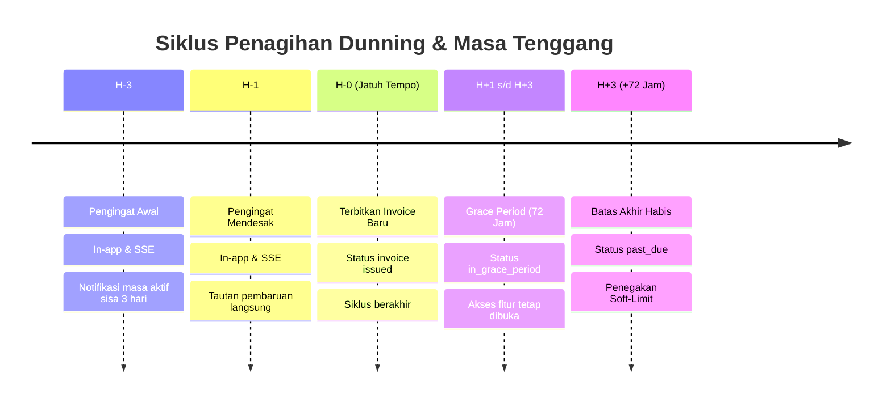

# Pengingat Tagihan & Masa Tenggang (Dunning & Grace Period)

Dokumen ini mendefinisikan jadwal otomatisasi pengingat penagihan (*dunning reminders*), penegakan masa tenggang (*grace period*), dan transisi penonaktifan fitur (*soft-limit*) pada FinTrack v2.

---

## 1. Arsitektur Siklus Dunning

Karena metode pembayaran transfer bank dan QRIS tidak mendukung penarikan dana otomatis (*auto-debit*), FinTrack v2 menerapkan sistem pengingat proaktif sebelum masa langganan berakhir untuk meminimalkan *involuntary churn*.



---

## 2. Rincian Tahapan Dunning

> **Konfigurasi dinamis (2026-10-14):** ambang pengingat tidak lagi hardcoded. Worker membaca
> `settings.dunning_hours_urgent` (default 24) dan `settings.dunning_hours_soon` (default 72)
> setiap kali `RunOnce` dijalankan, sehingga Super Admin dapat mengubah jeda pengingat dari
> halaman **Pengaturan** tanpa deploy ulang. Nilai `urgent` otomatis dibatasi agar tidak
> melebihi `soon` (monotonik), dan horizon pemindaian mengikuti nilai `soon`. Angka H-3/H-1
> di bawah adalah *default* bawaan.

### Tahap 1: Pengingat "Segera" (default ≤ 72 Jam Sebelum Jatuh Tempo)
- **Kondisi**: sisa waktu sebelum jatuh tempo ≤ `dunning_hours_soon` (default 72 jam) namun > `dunning_hours_urgent`.
- **Aksi Sistem**:
  1. Background worker membuat entri notifikasi tipe `SUBSCRIPTION_EXPIRING_SOON`.
  2. Menerbitkan event SSE ke frontend untuk menampilkan banner pengingat ramah: *"Masa aktif paket Anda tersisa 3 hari lagi. Perpanjang sekarang untuk menjaga kuota token AI Anda."*

### Tahap 2: Pengingat "Mendesak" (default ≤ 24 Jam Sebelum Jatuh Tempo)
- **Kondisi**: sisa waktu ≤ `dunning_hours_urgent` (default 24 jam) namun > 0.
- **Aksi Sistem**:
  1. Membuat entri notifikasi tipe `SUBSCRIPTION_EXPIRING_URGENT`.
  2. Banner frontend berubah warna menjadi kuning peringatan disertai tombol *Quick Renew*.

### Tahap 3: Penerbitan Tagihan H-0 (Hari Jatuh Tempo)
- **Kondisi**: `current_period_end` tercapai.
- **Aksi Sistem**:
  1. Menerbitkan invoice renewal baru dengan status `issued` dan `due_at = NOW() + 24 jam`.
  2. Jika metode renewal auto-debit aktif (misal kartu kredit tersimpan di token Midtrans), backend memicu `ChargePayment()`. Jika berhasil, siklus langsung diperpanjang.
  3. Jika metode non-otomatis, langganan memasuki masa tenggang (*grace period*).

---

## 3. Penegakan Masa Tenggang (Grace Period 72 Jam)

Sesuai keputusan **K-P05-12**, masa tenggang diberikan selama **72 jam** sejak invoice H-0 diterbitkan.

1. **Status Selama Masa Tenggang (`in_grace_period`)**:
   - Seluruh fitur AI, RAG chat, dan pencatatan keuangan tetap dapat diakses normal tanpa hambatan.
   - Di dashboard ditampilkan bilah informasi merah: *"Pembayaran langganan Anda tertunda. Masa tenggang tersisa X jam sebelum layanan dibatasi."*
2. **Kedaluwarsa Masa Tenggang**:
   - Jika setelah 72 jam tidak ada pembayaran yang terkonfirmasi `settled`:
     - `subscriptions.status` berubah menjadi `past_due`.
     - `invoices.status` yang belum terbayar diubah menjadi `past_due` atau `voided` tergantung kebijakan penagihan ulang.

---

## 4. Penegakan Batasan Lunak (Soft-Limit Policy)

Sesuai prinsip non-destruktif FinTrack v2:
1. **Tidak Ada Data Keuangan yang Dihapus**:
   - Riwayat transaksi, kategori anggaran, dompet, dan embedding yang telah tersimpan di PostgreSQL dan pgvector **TIDAK PERNAH DIHAPUS**.
2. **Pembatasan Hak Akses (*Entitlement Lock*)**:
   - Permintaan pembuatan chat AI baru atau embedding baru ditolak oleh backend middleware dengan error code `403 Entitlement Exceeded: Subscription Past Due`.
   - Akses data lama beralih ke mode hanya-baca (*read-only*).

---

## 5. Implementasi Worker Go di `internal/payment/dunning_worker.go`

```go
package payment

import (
	"context"
	"time"
)

type DunningWorker struct {
	repo       PaymentRepository
	notifier   NotificationService
	tickerTime time.Duration
}

func (w *DunningWorker) Start(ctx context.Context) {
	ticker := time.NewTicker(1 * time.Hour)
	defer ticker.Stop()

	for {
		select {
		case <-ctx.Done():
			return
		case <-ticker.C:
			w.processExpiringSubscriptions(ctx)
			w.processGracePeriodExpirations(ctx)
		}
	}
}

func (w *DunningWorker) processExpiringSubscriptions(ctx context.Context) {
	now := time.Now().In(time.FixedZone("WIB", 7*3600))
	// Cari langganan yang berakhir dalam rentang H-3 dan H-1 yang belum dikirimi notifikasi hari ini
	subsH3, _ := w.repo.GetExpiringSubscriptions(ctx, now.Add(48*time.Hour), now.Add(72*time.Hour), "H-3")
	for _, sub := range subsH3 {
		w.notifier.SendReminder(ctx, sub.UserID, "H-3", sub.CurrentPeriodEnd)
	}

	subsH1, _ := w.repo.GetExpiringSubscriptions(ctx, now.Add(1*time.Hour), now.Add(24*time.Hour), "H-1")
	for _, sub := range subsH1 {
		w.notifier.SendReminder(ctx, sub.UserID, "H-1", sub.CurrentPeriodEnd)
	}
}

func (w *DunningWorker) processGracePeriodExpirations(ctx context.Context) {
	now := time.Now()
	// Transisi langganan yang melewati grace period 72 jam tanpa pembayaran
	w.repo.MarkOverdueSubscriptionsAsPastDue(ctx, now.Add(-72*time.Hour))
}
```
