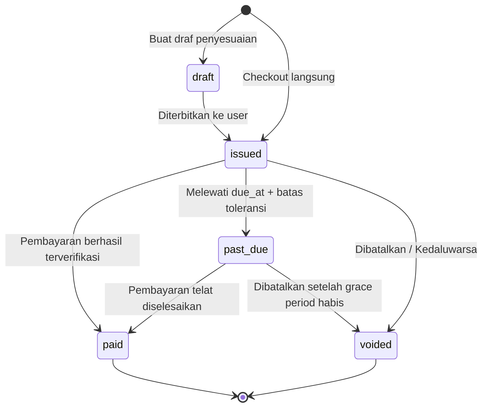

# Spesifikasi Invoice & Perpajakan (Invoice & Tax)

Dokumen ini mendefinisikan struktur data faktur (*invoice*), konvensi penomoran legal deterministik, siklus hidup status, serta arsitektur perpajakan dasar siap PPN (*tax-ready*) di FinTrack v2.

---

## 1. Skema Relasional Tabel `invoices`

Tabel `invoices` mencatat tagihan resmi yang diterbitkan untuk setiap transaksi langganan dan upgrade.

```sql
CREATE TYPE invoice_status_enum AS ENUM (
    'draft',
    'issued',
    'paid',
    'past_due',
    'voided'
);

CREATE TABLE IF NOT EXISTS invoices (
    id UUID PRIMARY KEY DEFAULT gen_random_uuid(),
    invoice_number VARCHAR(64) NOT NULL UNIQUE,
    user_id UUID NOT NULL REFERENCES users(id) ON DELETE RESTRICT,
    subscription_id UUID DEFAULT NULL REFERENCES subscriptions(id) ON DELETE SET NULL,
    subtotal_idr BIGINT NOT NULL CHECK (subtotal_idr >= 0),
    tax_idr BIGINT NOT NULL DEFAULT 0 CHECK (tax_idr >= 0),
    total_idr BIGINT NOT NULL CHECK (total_idr >= 0),
    status invoice_status_enum NOT NULL DEFAULT 'issued',
    issued_at TIMESTAMPTZ NOT NULL DEFAULT NOW(),
    due_at TIMESTAMPTZ NOT NULL,
    paid_at TIMESTAMPTZ DEFAULT NULL,
    voided_at TIMESTAMPTZ DEFAULT NULL,
    notes TEXT DEFAULT NULL,
    created_at TIMESTAMPTZ NOT NULL DEFAULT NOW(),
    updated_at TIMESTAMPTZ NOT NULL DEFAULT NOW()
);

CREATE INDEX IF NOT EXISTS idx_invoices_user_id ON invoices(user_id);
CREATE INDEX IF NOT EXISTS idx_invoices_status ON invoices(status);
CREATE INDEX IF NOT EXISTS idx_invoices_due_at ON invoices(due_at);
```

---

## 2. Aturan Penomoran Deterministik Legal

Sesuai keputusan **K-P05-09**, format nomor invoice FinTrack v2 adalah:

$$\text{INV}/\text{YYYYMMDD}/\text{SEQ}$$

Contoh: `INV/20261011/00042`

### Mekanisme Generator Sequence Atomic
Penomoran dihasilkan dengan fungsi PostgreSQL berbasis tanggal untuk menjamin keunikan tanpa celah balapan (*race-free*):

```sql
CREATE OR REPLACE FUNCTION generate_invoice_number() 
RETURNS TEXT AS $$
DECLARE
    today_str TEXT := TO_CHAR(NOW() AT TIME ZONE 'Asia/Jakarta', 'YYYYMMDD');
    seq_name TEXT := 'inv_seq_' || today_str;
    current_val BIGINT;
BEGIN
    -- Buat sequence harian jika belum ada
    EXECUTE FORMAT('CREATE SEQUENCE IF NOT EXISTS %I START 1;', seq_name);
    EXECUTE FORMAT('SELECT nextval(%L);', seq_name) INTO current_val;
    RETURN 'INV/' || today_str || '/' || LPAD(current_val::TEXT, 5, '0');
END;
$$ LANGUAGE plpgsql;
```

---

## 3. Matriks Transisi Status Invoice



### Aturan Transisi:
1. Status `paid` adalah terminal: tidak dapat diubah menjadi `voided` secara sepihak. Bila terjadi pembatalan/sengketa, diperlukan dokumen memo kredit khusus di tingkat audit.
2. Status `voided` menghentikan seluruh upaya penagihan aktif dan membatalkan token pembayaran gateway terkait.

---

## 4. Desain Siap PPN (Tax-Ready Architecture)

Sesuai keputusan **K-11** dan **K-P05-10**, invoice dirancang siap menampung regulasi PPN tanpa migrasi ulang skema di kemudian hari.

### Rumus Perhitungan:
$$\text{tax\_idr} = \left\lfloor \frac{\text{subtotal\_idr} \times \text{tax\_rate\_percent}}{100} \right\rfloor$$
$$\text{total\_idr} = \text{subtotal\_idr} + \text{tax\_idr}$$

### Konfigurasi:
- Kolom `settings.tax_rate_percent` menyimpan nilai integer persentase pajak (default `0`).
- Jika regulasi mewajibkan PPN 11% atau 12%, super admin cukup memperbarui nilai setting menjadi `11` atau `12`.
- Seluruh tagihan baru yang terbit otomatis mengalkulasikan `tax_idr` dengan pembulatan ke bawah (*floor*).

---

## 5. Representasi Data JSON Klien

```json
{
  "invoice_number": "INV/20261011/00042",
  "status": "issued",
  "issued_at": "2026-10-11T10:00:00+07:00",
  "due_at": "2026-10-12T10:00:00+07:00",
  "currency": "IDR",
  "items": [
    {
      "description": "Langganan FinTrack Pro (30 Hari)",
      "amount_idr": 99000
    }
  ],
  "subtotal_idr": 99000,
  "tax_idr": 0,
  "total_idr": 99000
}
```
Semua angka dicetak dalam format integer rupiah tanpa nilai sen.
