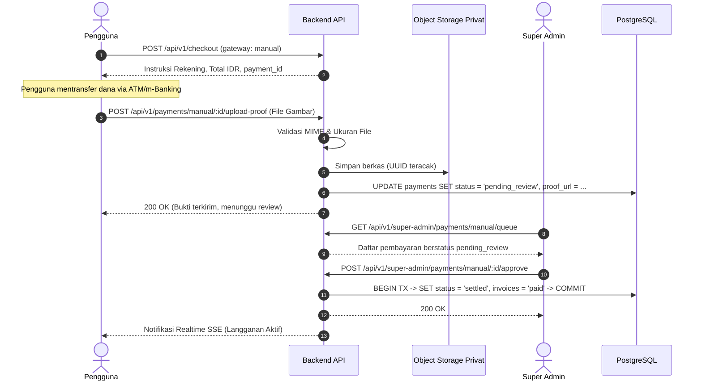

# Pembayaran Manual & Alur Persetujuan (Manual Payment)

Dokumen ini menjelaskan rancangan alur pembayaran transfer manual, pengunggahan bukti bayar, validasi keamanan berkas, serta antrean peninjauan oleh super admin di FinTrack v2.

---

## 1. Alur Bisnis Pembayaran Manual

Pembayaran manual dirancang untuk transaksi transfer antarbank langsung atau QRIS statis tanpa gerbang pembayaran pihak ketiga.



---

## 2. Validasi & Penyimpanan Bukti Transfer

Untuk mencegah celah keamanan unggah berkas (*unrestricted file upload*), sistem menerapkan aturan ketat:

1. **Pemeriksaan Konten Asli (Magic Bytes)**:
   - Header berkas diperiksa menggunakan deteksi signature biner (`http.DetectContentType`), bukan hanya ekstensi nama file.
   - Hanya tipe MIME berikut yang diterima:
     - `image/jpeg`
     - `image/png`
     - `image/webp`
2. **Batas Ukuran Berkas**:
   - Maksimal ukuran payload multipart adalah 5 MB. Permintaan melebihi batas ini ditolak dengan HTTP `413 Payload Too Large`.
3. **Penyimpanan Terisolasi & Pengacakan Nama**:
   - Nama berkas asli dibuang. Berkas disimpan dengan penamaan format UUIDv4:
     `uploads/proofs/2026/10/{uuid-v4}.{ext}`
   - Berkas diletakkan di storage privat dan diakses oleh admin hanya melalui endpoint yang divalidasi otorisasi `super_admin`.

---

## 3. Spesifikasi Endpoint Super Admin

Semua endpoint berikut dilindungi oleh middleware `RequireSuperAdmin`:

### A. Melihat Antrean Verifikasi
- **Method**: `GET`
- **Path**: `/api/v1/super-admin/payments/manual/queue`
- **Query Params**: `page=1&limit=20&sort=created_at&order=desc`
- **Response**:
  ```json
  {
    "data": [
      {
        "id": "e838b9d2-3580-4927-a021-e970bcf3fbf2",
        "invoice_number": "INV/20261011/00012",
        "user_email": "user@example.com",
        "user_name": "Budi Santoso",
        "amount_idr": 99000,
        "proof_url": "/api/v1/super-admin/payments/manual/proofs/uuid-abc.jpg",
        "status": "pending_review",
        "created_at": "2026-10-11T14:20:00+07:00"
      }
    ],
    "pagination": { "page": 1, "limit": 20, "total": 1 }
  }
  ```

### B. Persetujuan Pembayaran (Approve)
- **Method**: `POST`
- **Path**: `/api/v1/super-admin/payments/manual/:id/approve`
- **Payload**:
  ```json
  {
    "admin_note": "Mutasi bank BCA pukul 14:35 cocok."
  }
  ```
- **Efek Sistem**:
  1. `payments.status` berubah menjadi `settled`, `settled_at = NOW()`.
  2. `invoices.status` berubah menjadi `paid`, `paid_at = NOW()`.
  3. Mengaktifkan paket langganan dan memperbarui kuota token user.
  4. Mencatat entri di `audit_logs` (Aktor: Super Admin ID, Aksi: `MANUAL_PAYMENT_APPROVE`).
  5. Memancarkan event SSE ke user.

### C. Penolakan Pembayaran (Reject)
- **Method**: `POST`
- **Path**: `/api/v1/super-admin/payments/manual/:id/reject`
- **Payload**:
  ```json
  {
    "rejection_reason": "Bukti transfer buram dan tidak terbaca."
  }
  ```
- **Efek Sistem**:
  1. `payments.status` berubah menjadi `failed`.
  2. `invoices.status` tetap `issued` (user dapat mengunggah bukti baru atau mengganti metode).
  3. Mencatat entri di `audit_logs` (Aktor: Super Admin ID, Aksi: `MANUAL_PAYMENT_REJECT`).
  4. Mengirim notifikasi alasan penolakan ke user.

---

## 4. Keamanan & Akuntabilitas

Setiap tindakan persetujuan atau penolakan bersifat final dan tidak dapat diubah tanpa jejak audit. Admin tidak dapat menyetujui transaksi milik invoice yang sudah berstatus `paid` atau `voided` untuk mencegah anomali pembukuan.
