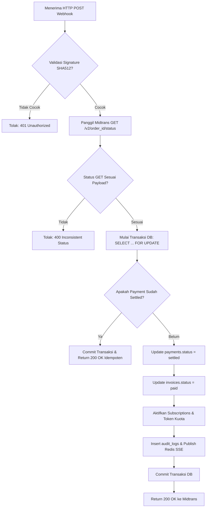

# Penanganan Webhook Midtrans (Midtrans Webhook)

Dokumen ini mendefinisikan mekanisme penerimaan, verifikasi keamanan, idempotensi, dan pemrosesan state machine webhook dari Midtrans di FinTrack v2.

---

## 1. Spesifikasi Endpoint Webhook

- **Path**: `POST /api/v1/payments/webhook/midtrans`
- **Autentikasi**: Publik (tanpa header Authorization JWT).
- **Format Payload**: JSON (Midtrans HTTP Notification).
- **Keamanan**: Validasi Signature SHA-512 dan verifikasi ulang (*pull validation*) ke API status resmi Midtrans.

---

## 2. Verifikasi Signature HMAC SHA-512

Sesuai spesifikasi Midtrans, webhook menyertakan field `signature_key` di dalam body JSON. Backend FinTrack memvalidasi keaslian payload dengan formula:

$$\text{Calculated Signature} = \text{SHA512}(\text{order\_id} + \text{status\_code} + \text{gross\_amount} + \text{server\_key})$$

### Implementasi Verifikasi Go
```go
package payment

import (
	"crypto/sha512"
	"encoding/hex"
	"errors"
	"fmt"
	"strings"
)

func VerifyMidtransSignature(orderID, statusCode, grossAmount, serverKey, incomingSignature string) error {
	rawString := fmt.Sprintf("%s%s%s%s", orderID, statusCode, grossAmount, serverKey)
	hasher := sha512.New()
	hasher.Write([]byte(rawString))
	calculatedSignature := hex.EncodeToString(hasher.Sum(nil))

	if !strings.EqualFold(calculatedSignature, incomingSignature) {
		return errors.New("signature mismatch: potensi payload palsu atau tampering")
	}
	return nil
}
```

Jika signature tidak cocok, handler segera menghentikan pemrosesan dan mengembalikan HTTP `401 Unauthorized`.

---

## 3. Verifikasi Ulang Independen (Pull Validation)

Untuk mencegah serangan replay atau celah perantara, backend tidak langsung mempercayai isi webhook meskipun signature valid. Backend melakukan panggilan GET balik ke server Midtrans:

```
GET https://api.midtrans.com/v2/{order_id}/status
Authorization: Basic base64(SERVER_KEY + ":")
```

Nilai `transaction_status`, `status_code`, dan `gross_amount` yang dikembalikan dari panggilan GET inilah yang menjadi acuan final pembaruan status sistem.

---

## 4. Mekanisme Idempotensi & Concurrency Lock

Webhook dapat dikirim berulang kali oleh Midtrans jika jaringan mengalami jitter atau ACK terlambat. FinTrack menerapkan dua lapisan pengamanan:

1. **Pessimistic Concurrency Lock**:
   ```sql
   BEGIN;
   SELECT id, status, invoice_id, amount_idr
   FROM payments
   WHERE gateway_ref = $1
   FOR UPDATE;
   ```
2. **Kekangan Idempotency Key**:
   - Kolom `idempotency_key` pada `payments` dibuat unik dengan nilai:
     `order_id + ":" + transaction_status + ":" + status_code`
   - Jika status baris yang dikunci sudah berada pada status `settled` atau status akhir lainnya, transaksi di-*commit* segera dan mengembalikan HTTP `200 OK` tanpa mengeksekusi aktivasi langganan ulang.

---

## 5. Pemetaan Status Midtrans ke Domain FinTrack

| Midtrans `transaction_status` | `fraud_status` | FinTrack `payment_status` | FinTrack `invoice_status` | Tindakan Domain |
|---|---|---|---|---|
| `capture` | `accept` | `settled` | `paid` | Aktivasi kuota & plan langganan |
| `settlement` | (tidak relevan) | `settled` | `paid` | Aktivasi kuota & plan langganan |
| `pending` | (tidak relevan) | `pending` | `issued` | Menunggu pembayaran user |
| `deny` | (tidak relevan) | `failed` | `issued` (bisa coba lagi) | Catat log kegagalan |
| `cancel` | (tidak relevan) | `failed` | `voided` | Batalkan tagihan |
| `expire` | (tidak relevan) | `expired` | `voided` | Tagihan kedaluwarsa |
| `refund` | (tidak relevan) | `refunded` | `voided` | Cabut entitlement & catat audit |

---

## 6. Diagram Alur Pemrosesan Webhook


