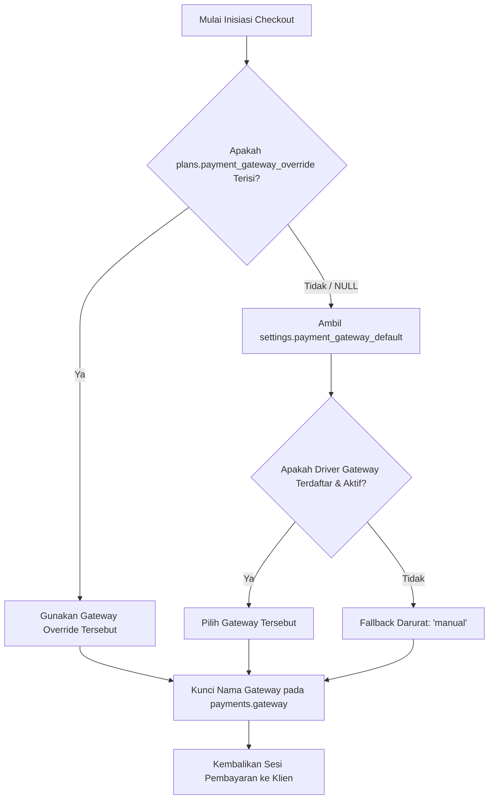

# Mekanisme Pengalihan Gateway Pembayaran (Payment Gateway Switch)

Dokumen ini mendefinisikan tata cara pengalihan gerbang pembayaran secara dinamis (*runtime switch*), hierarki resolusi gateway global versus paket (*per-plan override*), serta mitigasi transaksi yang sedang berjalan (*in-flight transactions*) di FinTrack v2.

---

## 1. Latar Belakang & Kebutuhan Bisnis

Berdasarkan keputusan **K-10** dan **K-P05-06**, sistem harus mampu beralih antar payment gateway (misal dari Midtrans ke Manual atau gateway baru di masa depan) sewaktu-waktu tanpa:
1. Membutuhkan proses *restart* server atau *re-deployment* kode aplikasi.
2. Menggagalkan atau memutus transaksi yang sudah dibuka oleh pengguna namun belum diselesaikan (*in-flight*).
3. Mengubah riwayat rekonsiliasi dan verifikasi transaksi terdahulu.

---

## 2. Model Data Konfigurasi Gateway

Konfigurasi disimpan pada dua level di PostgreSQL:

### Level 1: Global Default Setting
Tabel `settings` menampung konfigurasi bawaan sistem:
```sql
-- Cuplikan baris konfigurasi global
INSERT INTO settings (key, value, description)
VALUES 
    ('payment_gateway_default', 'midtrans', 'Gateway pembayaran default: midtrans | manual')
ON CONFLICT (key) DO UPDATE SET value = EXCLUDED.value;
```

### Level 2: Override Per-Paket (Plan-Level)
Kolom `payment_gateway_override` pada tabel `plans` memungkinkan paket tertentu dipaksa menggunakan jalur pembayaran khusus:
```sql
ALTER TABLE plans 
ADD COLUMN IF NOT EXISTS payment_gateway_override VARCHAR(32) DEFAULT NULL;
-- Contoh: Paket Enterprise diwajibkan transfer manual
UPDATE plans SET payment_gateway_override = 'manual' WHERE slug = 'enterprise';
```

---

## 3. Resolusi Hierarki Gateway (Resolver Engine)

Saat klien memanggil endpoint `POST /api/v1/checkout`, engine resolver menentukan gateway dengan urutan prioritas:



### Implementasi Go di `internal/payment/resolver.go`:
```go
package payment

import (
	"context"
	"strings"
)

type GatewayResolver struct {
	settingsRepo SettingsRepository
	plansRepo    PlansRepository
	drivers      map[string]Gateway
}

func (r *GatewayResolver) ResolveForPlan(ctx context.Context, planID string) (Gateway, error) {
	plan, err := r.plansRepo.GetByID(ctx, planID)
	if err == nil && plan.PaymentGatewayOverride != nil && strings.TrimSpace(*plan.PaymentGatewayOverride) != "" {
		if gw, exists := r.drivers[*plan.PaymentGatewayOverride]; exists {
			return gw, nil
		}
	}

	defaultGwName, err := r.settingsRepo.GetString(ctx, "payment_gateway_default")
	if err == nil {
		if gw, exists := r.drivers[defaultGwName]; exists {
			return gw, nil
		}
	}

	// Fallback aman jika gateway belum terdaftar
	return r.drivers["manual"], nil
}
```

---

## 4. Penanganan Transaksi Berjalan (In-Flight Isolation)

Prinsip penting pergantian gateway adalah **isolasi transaksi berjalan**:

1. **Penguncian Permanen Gateway**:
   - Kolom `payments.gateway` menyimpan nama gateway yang digunakan saat baris tersebut pertama kali dibuat.
   - Kolom ini **TIDAK PERNAH DIUBAH** meskipun setting global atau override plan diganti sedetik kemudian.
2. **Routing Webhook & Verifikasi Status Mandiri**:
   - Ketika notifikasi atau verifikasi status diproses, sistem membaca `payments.gateway` milik baris tersebut untuk memilih driver gateway yang bertanggung jawab:
     ```go
     func (s *PaymentService) ProcessCallback(ctx context.Context, orderID string, payload []byte) error {
         payment, _ := s.repo.GetByOrderID(ctx, orderID)
         driver := s.registry.Get(payment.Gateway) // Menggunakan gateway asli order_id tersebut
         return driver.HandleCallback(ctx, payment, payload)
     }
     ```
3. **Masa Kedaluwarsa Sesi Pembayaran**:
   - Setiap sesi gateway memiliki batas waktu kedaluwarsa tegas (misal Midtrans Snap token 24 jam).
   - Setelah 24 jam, transaksi *in-flight* yang tidak dibayar otomatis kedaluwarsa (`expired`), sehingga user dipaksa melakukan checkout baru yang otomatis menggunakan konfigurasi gateway terbaru.

---

## 5. Prosedur Operasional Pengalihan (SOP Super Admin)

Jika penyedia gateway utama mengalami gangguan layanan (*outage*):
1. Super admin membuka menu konfigurasi sistem atau memanggil API:
   `PATCH /api/v1/super-admin/settings { "key": "payment_gateway_default", "value": "manual" }`
2. Konfigurasi tersimpan di PostgreSQL dan Redis cache di-*invalidate* seketika.
3. Seluruh permintaan checkout baru mulai detik tersebut langsung diarahkan ke halaman transfer manual.
4. Transaksi lama yang telah memiliki Snap Token tetap dapat menerima webhook dari Midtrans tanpa gangguan.
