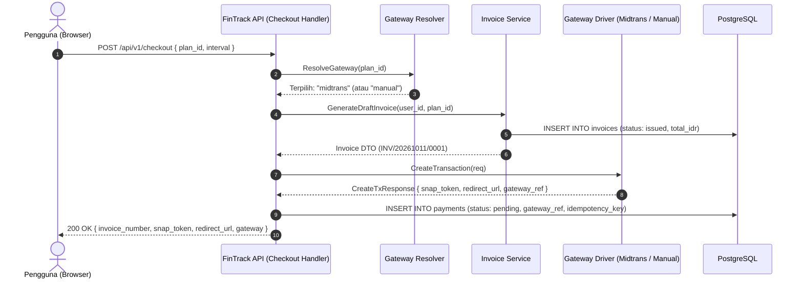

# Integrasi Pembayaran (Payment Integration)

Dokumen ini menjelaskan arsitektur antarmuka modul `internal/payment/`, model entitas database, serta alur inisiasi transaksi pembayaran di FinTrack v2.

---

## 1. Arsitektur Antarmuka Gateway

Sesuai keputusan **K-P05-03**, seluruh vendor pembayaran diisolasi di balik antarmuka Go yang konsisten. Modul penagihan tingkat domain (`internal/billing/`) hanya berinteraksi dengan antarmuka ini tanpa mengetahui implementasi teknis gateway di bawahnya.

```go
package payment

import (
	"context"
	"time"
)

// Gateway mendefinisikan kontrak standar bagi seluruh provider pembayaran.
type Gateway interface {
	// Name mengembalikan identitas unik gateway ("midtrans" atau "manual").
	Name() string

	// CreateTransaction menginisialisasi sesi pembayaran baru dan mengembalikan token/instruksi.
	CreateTransaction(ctx context.Context, req CreateTxRequest) (*CreateTxResponse, error)

	// VerifyWebhook memvalidasi keaslian payload dan signature notifikasi callback.
	VerifyWebhook(ctx context.Context, payload []byte, headers map[string]string) (*WebhookResult, error)

	// CheckStatus memeriksa status transaksi terkini langsung ke server gateway.
	CheckStatus(ctx context.Context, gatewayRef string) (*StatusResult, error)

	// CancelTransaction membatalkan transaksi yang belum diselesaikan.
	CancelTransaction(ctx context.Context, gatewayRef string) error
}

// CreateTxRequest membawa data transaksi untuk diinisiasi di gateway.
type CreateTxRequest struct {
	InvoiceNumber string            `json:"invoice_number"`
	AmountIDR     int64             `json:"amount_idr"` // Integer rupiah
	UserID        string            `json:"user_id"`
	UserEmail     string            `json:"user_email"`
	UserName      string            `json:"user_name"`
	ItemName      string            `json:"item_name"`
	ExpiryMinutes int               `json:"expiry_minutes"`
	Metadata      map[string]string `json:"metadata"`
}

// CreateTxResponse mengembalikan token/instruksi bagi klien.
type CreateTxResponse struct {
	GatewayRef  string `json:"gateway_ref"`  // Order ID atau Transaction ID unik
	RedirectURL string `json:"redirect_url"` // URL checkout gateway (jika ada)
	SnapToken   string `json:"snap_token"`   // Snap Token khusus Midtrans (jika ada)
	Instructions string `json:"instructions"` // Instruksi transfer manual / rekening
}

// WebhookResult hasil parsing dan validasi callback webhook.
type WebhookResult struct {
	GatewayRef     string    `json:"gateway_ref"`
	RawStatus      string    `json:"raw_status"`
	NormalizedStatus PaymentStatus `json:"normalized_status"` // settled, failed, expired, pending
	AmountIDR      int64     `json:"amount_idr"`
	PaymentMethod  string    `json:"payment_method"`
	PaidAt         *time.Time `json:"paid_at"`
	SignatureValid bool      `json:"signature_valid"`
}

// StatusResult hasil pengecekan langsung ke vendor.
type StatusResult struct {
	GatewayRef       string        `json:"gateway_ref"`
	NormalizedStatus PaymentStatus `json:"normalized_status"`
	RawResponse      []byte        `json:"raw_response"`
}
```

---

## 2. Skema Relasional Database

Struktur tabel `payments` dan hubungannya dengan `invoices` diatur secara ketat dengan penegakan tipe data integer rupiah:

```sql
-- Status enum pembayaran
CREATE TYPE payment_status_enum AS ENUM (
    'pending',
    'pending_review',
    'settled',
    'failed',
    'expired',
    'refunded'
);

-- Tabel pembayaran
CREATE TABLE IF NOT EXISTS payments (
    id UUID PRIMARY KEY DEFAULT gen_random_uuid(),
    invoice_id UUID NOT NULL REFERENCES invoices(id) ON DELETE RESTRICT,
    user_id UUID NOT NULL REFERENCES users(id) ON DELETE RESTRICT,
    gateway VARCHAR(32) NOT NULL, -- 'midtrans' | 'manual'
    gateway_ref VARCHAR(128) NOT NULL, -- order_id atau ref tracking
    amount_idr BIGINT NOT NULL CHECK (amount_idr >= 0),
    status payment_status_enum NOT NULL DEFAULT 'pending',
    payment_method VARCHAR(64) DEFAULT NULL, -- 'credit_card', 'gopay', 'bca_va', 'manual_transfer'
    proof_url TEXT DEFAULT NULL, -- URL bukti transfer (khusus manual)
    idempotency_key VARCHAR(128) NOT NULL UNIQUE,
    payload_snapshot JSONB DEFAULT NULL,
    created_at TIMESTAMPTZ NOT NULL DEFAULT NOW(),
    updated_at TIMESTAMPTZ NOT NULL DEFAULT NOW(),
    settled_at TIMESTAMPTZ DEFAULT NULL
);

-- Indeks efisiensi query
CREATE INDEX IF NOT EXISTS idx_payments_gateway_ref ON payments(gateway_ref);
CREATE INDEX IF NOT EXISTS idx_payments_user_id ON payments(user_id);
CREATE INDEX IF NOT EXISTS idx_payments_invoice_id ON payments(invoice_id);
CREATE INDEX IF NOT EXISTS idx_payments_status ON payments(status);
```

---

## 3. Alur Inisiasi Transaksi (Checkout Flow)

Diagram alur berikut mengilustrasikan inisiasi checkout dari klien hingga pembuatan token gateway:



---

## 4. Penanganan Error & Ketahanan Jaringan

1. **Timeout HTTP Client**:
   - HTTP client yang memanggil gateway eksternal dikonfigurasi dengan batas waktu `timeout = 10 detik` dan `keep-alive = 30 detik`.
2. **Kompensasi Kegagalan Pembuatan Token**:
   - Jika panggilan ke Midtrans Snap API gagal akibat gangguan jaringan pihak ketiga, transaksi invoice dibatalkan (*voided*) dan error `502 Bad Gateway` dikembalikan dengan pesan ramah pengguna.
3. **Penyimpanan Snapshot Payload**:
   - Setiap respons yang diterima dari vendor pembayaran saat inisiasi disimpan di kolom `payload_snapshot` untuk audit dan penelusuran jika timbul sengketa teknis.
