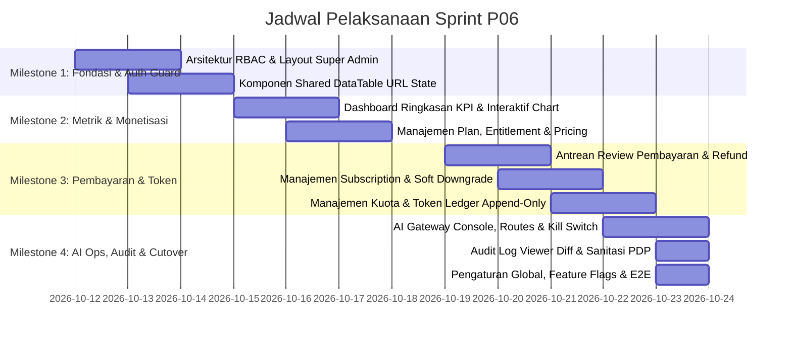

# Sprint Plan — Fase P06 (Super Admin Dashboard)

## Informasi Sprint
- **Fase**: P06 (Super Admin Dashboard)
- **Durasi**: 2 Pekan (10 Hari Kerja)
- **Fokus Utama**: Implementasi menyeluruh antarmuka web Super Admin Next.js 16 (`app/(dashboard)/super-admin/*`), komponen data tabular seragam `<DataTable>`, visualisasi analitik interaktif Recharts, serta handler backend Go/Gin terproteksi role `super_admin` ber-audit log lengkap.
- **Pendekatan**: Hibrida A+B (Strangler Fig), Zero Downtime, Backend Otoritatif.

---

## Milestone & Alokasi Siklus Kerja

---

## Rincian Milestone

### Milestone 1: Fondasi Otorisasi, Navigasi, dan Standarisasi `<DataTable>` (Hari 1 - 3)
- **Target**: Membangun fondasi rute admin backend & frontend, middleware otorisasi `super_admin`, struktur navigasi sidebar admin, serta komponen bersama `<DataTable>` berbasis TanStack Table v8.
- **Aktivitas Kunci**:
  1. Setup handler backend `internal/admin` dengan middleware `RequireSuperAdmin()`.
  2. Implementasi layout Next.js `app/(dashboard)/super-admin/layout.tsx` dengan server-side session check.
  3. Pembuatan komponen reusable `components/data-table/data-table.tsx` dengan fitur pagination 20 baris, sorting, search debounce, penomoran urut, dan sinkronisasi search params URL (`?page=&sort=&order=&q=`).
  4. Penyusunan sidebar navigasi admin dengan badge indikator notifikasi (antrean pending payment & alert circuit breaker).

### Milestone 2: Dashboard Ringkasan Eksekutif, Chart Analitik & Manajemen Plan (Hari 4 - 5)
- **Target**: Menyelesaikan landing page dashboard analitik utama dan modul CRUD katalog Plan lengkap dengan konfigurasi entitlement & dynamic pricing rules.
- **Aktivitas Kunci**:
  1. Pembuatan endpoint backend `/api/v1/admin/metrics/overview` (agregasi MRR, active users, token usage, payment rate) dengan caching Redis TTL 60 detik.
  2. Implementasi widget KPI cards dan grafik interaktif Recharts (AreaChart pendapatan, BarChart konsumsi token harian, PieChart gateway split) dengan fitur drill-down.
  3. Pembuatan halaman `/super-admin/plans` menggunakan `<DataTable>` untuk daftar paket.
  4. Implementasi form dialog modal/drawer untuk pembuatan & edit Plan: centang boolean entitlement, limit numerik, aturan harga dasar IDR, multiplier markup token AI, dan gateway override.

### Milestone 3: Operasional Subscription, Review Pembayaran & Ledger Token (Hari 6 - 8)
- **Target**: Membangun antarmuka operasional harian admin untuk intervensi langganan, verifikasi pembayaran manual, dan manajemen penyesuaian saldo token AI.
- **Aktivitas Kunci**:
  1. Halaman `/super-admin/subscriptions`: Tabel monitoring status langganan, modal aksi `Extend Period`, `Cancel`, dan `Force Downgrade` dengan prinsip Soft-Limit (K-09).
  2. Halaman `/super-admin/payments/review`: Antrean verifikasi bukti transfer manual, dialog pratinjau bukti bayar, tombol `Approve` / `Reject` dengan proteksi pencegahan race condition, serta dialog pencatatan `Record Refund`.
  3. Halaman `/super-admin/tokens`: Daftar saldo token user, riwayat ledger transaksi token, dan modal formulir `Manual Token Adjustment` yang mewajibkan input `idempotency_key` dan pencatatan alasan administratif ke audit log.

### Milestone 4: AI Gateway Control Center, Audit Log Viewer & Platform Settings (Hari 9 - 10)
- **Target**: Menyelesaikan pusat kendali operasional AI Gateway, antarmuka penampil jejak audit dengan kepatuhan UU PDP, pengaturan global platform, serta verifikasi integrasi akhir.
- **Aktivitas Kunci**:
  1. Halaman `/super-admin/ai-gateway`: Manajemen pool endpoint AI, pemetaan routing use-case (chat, vision, voice, embedding), indikator real-time health/latency/error, tombol reset circuit breaker, dan Emergency Kill Switch.
  2. Halaman `/super-admin/audit`: Tabel jejak audit log (`/super-admin/audit`) dengan filter aktor/waktu/entitas, modal inspeksi diff JSON `before` vs `after`, serta pembersihan data sensitif sesuai UU PDP No. 27/2022.
  3. Halaman `/super-admin/settings`: Konfigurasi global default payment gateway (K-10), durasi grace period, default pricing token, dan toggle feature flags platform.
  4. Pengujian menyeluruh lintas modul (smoke test otorisasi, validasi URL state table, verifikasi append-only audit trail).

---

## Manajemen Risiko & Rencana Mitigasi

| Risiko | Dampak | Probabilitas | Rencana Mitigasi |
|---|---|---|---|
| Query agregasi MRR & token membebani database utama | Tinggi | Sedang | Gunakan indeks parsial pada tabel transaksi/token, terapkan caching Redis terisolasi TTL 60 detik dengan stale-while-revalidate |
| Dua admin menyetujui transaksi pembayaran manual yang sama secara bersamaan | Tinggi | Rendah | Terapkan optimistic lock (`version` field) atau pessimistic row-lock `SELECT ... FOR UPDATE` pada saat mutasi pembayaran diproses |
| Admin salah melakukan force downgrade sehingga data user terhapus | Fatal | Sangat Rendah | Terapkan aturan arsitektur K-09 (Soft-Limit): handler downgrade DILARANG KERAS mengeksekusi perintah SQL `DELETE` pada data transaksi/budget user |
| Data kredensial/rahasia bocor di halaman Audit Log Viewer | Tinggi | Rendah | Masking otomatis pada level backend serializer JSON sebelum payload audit dikirim ke browser (K-P06-09) |
| URL search params desync dengan state internal table | Sedang | Rendah | Menggunakan pattern single source of truth: table membaca nilai langsung dari URL params dan melakukan update via Next.js router replace shallow |
