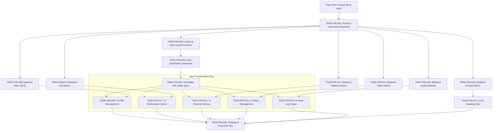

# Timeline & Matriks Dependensi — Fase P06 (Super Admin Dashboard)

Dokumen ini memetakan urutan pengerjaan sekuensial, ketergantungan antar-task (dependency graph), jalur kritis (critical path), dan estimasi jadwal kerja untuk seluruh 20 tugas pada fase P06.

---

## Matriks Ketergantungan Task (Dependency Matrix)

| ID Task | Judul Task | Dependensi Wajib | Target Selesai |
|---|---|---|---|
| **TASK-P06-001** | Backend Super Admin Route Group & RBAC Middleware | Fase P02 (Auth/DB Foundation) | Hari 1 |
| **TASK-P06-002** | Frontend Super Admin Layout, Auth Guard & Sidebar | TASK-P06-001 | Hari 2 |
| **TASK-P06-003** | Komponen Reusable `<DataTable>` TanStack Table v8 | TASK-P06-002 | Hari 3 |
| **TASK-P06-004** | Sinkronisasi Status `<DataTable>` dengan URL Search Params | TASK-P06-003 | Hari 3 |
| **TASK-P06-005** | Backend Endpoint Agregasi Metrik & KPI Dashboard | TASK-P06-001 | Hari 4 |
| **TASK-P06-006** | Antarmuka Dashboard Ringkasan & Kartu KPI | TASK-P06-002, TASK-P06-005 | Hari 4 |
| **TASK-P06-007** | Visualisasi Analitik Interaktif Berbasis Recharts | TASK-P06-006 | Hari 5 |
| **TASK-P06-008** | Backend Plan & Entitlement Admin CRUD Handler | TASK-P06-001, Fase P04 (Billing DB) | Hari 5 |
| **TASK-P06-009** | Antarmuka Manajemen Katalog Plan & Form Konfigurasi | TASK-P06-003, TASK-P06-004, TASK-P06-008 | Hari 6 |
| **TASK-P06-010** | Backend Subscription Management & Intervensi Manual | TASK-P06-001, Fase P04 | Hari 6 |
| **TASK-P06-011** | Antarmuka Monitoring & Intervensi Subscription | TASK-P06-003, TASK-P06-004, TASK-P06-010 | Hari 7 |
| **TASK-P06-012** | Backend Payment Review, Settlement & Refund Handler | TASK-P06-001, Fase P05 (Payment DB) | Hari 7 |
| **TASK-P06-013** | Antarmuka Antrean Verifikasi Pembayaran & Dialog Refund | TASK-P06-003, TASK-P06-004, TASK-P06-012 | Hari 8 |
| **TASK-P06-014** | Backend Token Ledger Admin Handler & Idempotent Adjust | TASK-P06-001, Fase P03 (Token DB) | Hari 8 |
| **TASK-P06-015** | Antarmuka Saldo Token Pengguna & Form Penyesuaian | TASK-P06-003, TASK-P06-004, TASK-P06-014 | Hari 8 |
| **TASK-P06-016** | Backend AI Gateway Operations & Kill Switch Handler | TASK-P06-001, Fase P03 (AI Gateway) | Hari 9 |
| **TASK-P06-017** | Antarmuka Pusat Kendali AI Gateway & Monitoring | TASK-P06-002, TASK-P06-016 | Hari 9 |
| **TASK-P06-018** | Backend Audit Log Query Handler & Sanitasi Data PDP | TASK-P06-001 | Hari 9 |
| **TASK-P06-019** | Antarmuka Audit Log Viewer dengan Diff JSON Inspeksi | TASK-P06-003, TASK-P06-004, TASK-P06-018 | Hari 10 |
| **TASK-P06-020** | Antarmuka Pengaturan Sistem Global & E2E Validation | TASK-P06-001 s/d TASK-P06-019 | Hari 10 |

---

## Diagram Jalur Kritis (Critical Path)

Jalur kritis menentukan rangkaian tugas terpanjang yang secara langsung membatasi tanggal penyelesaian sprint. Keterlambatan pada jalur ini akan menggeser rilis akhir:

### Rincian Jalur Kritis:
1. **Fondasi Awal (Hari 1 - 3)**: `TASK-P06-001` (Backend Auth) $\rightarrow$ `TASK-P06-002` (Frontend Layout) $\rightarrow$ `TASK-P06-003` (Core DataTable) $\rightarrow$ `TASK-P06-004` (DataTable URL State).
2. **Implementasi Modul Kritis (Hari 4 - 8)**: Modul-modul tabel tabular dibangun secara paralel setelah `TASK-P06-004` siap.
3. **Penyatuan & Validasi Akhir (Hari 9 - 10)**: `TASK-P06-020` (Settings & E2E Validation) menyatukan seluruh modul dan memastikan kepatuhan standar DoD sebelum fase dinyatakan selesai.

---

## Jadwal Kerja Sekuensial (Harian)

- **Hari 1**: Implementasi backend admin route group, gin engine mapping, dan middleware `RequireSuperAdmin()` (`TASK-P06-001`).
- **Hari 2**: Setup folder Next.js `app/(dashboard)/super-admin/layout.tsx`, server-side auth guard, dan sidebar navigasi (`TASK-P06-002`).
- **Hari 3**: Pengembangan komponen inti generic `<DataTable>` dan integrasi TanStack Table v8 dengan URL Search Params (`TASK-P06-003`, `TASK-P06-004`).
- **Hari 4**: Backend endpoint agregasi KPI (`TASK-P06-005`) dan pembuatan antarmuka dashboard utama beserta kartu ringkasan KPI (`TASK-P06-006`).
- **Hari 5**: Pembangunan komponen grafik analitik Recharts (`TASK-P06-007`) dan backend CRUD katalog Plan & Entitlement (`TASK-P06-008`).
- **Hari 6**: Pembangunan UI katalog Plan dengan modal konfigurasi entitlement & dynamic pricing (`TASK-P06-009`) serta backend subscription management (`TASK-P06-010`).
- **Hari 7**: Antarmuka monitoring subscription & aksi intervensi (`TASK-P06-011`) dan backend payment review & refund handler (`TASK-P06-012`).
- **Hari 8**: Antarmuka antrean review pembayaran & dialog refund (`TASK-P06-013`), backend token ledger admin (`TASK-P06-014`), serta UI penyesuaian saldo token (`TASK-P06-015`).
- **Hari 9**: Backend dan antarmuka pusat kendali AI Gateway, routing matrix, kill switch (`TASK-P06-016`, `TASK-P06-017`), serta backend query audit log dengan masking PDP (`TASK-P06-018`).
- **Hari 10**: Antarmuka Audit Log Viewer dengan diff JSON inspeksi (`TASK-P06-019`), halaman Settings Platform Global, dan eksekusi skenario uji integrasi menyeluruh E2E (`TASK-P06-020`).
