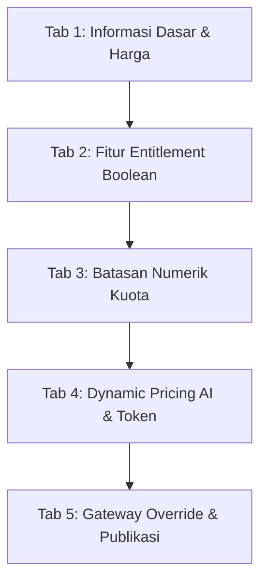

# Antarmuka Manajemen Katalog Plan — FinTrack v2

Dokumen ini menguraikan spesifikasi antarmuka manajemen paket (`/super-admin/plans`), konfigurasi entitlement fitur, batasan numerik, aturan dynamic pricing token AI, dan pemilihan gateway override pada FinTrack v2.

---

## 1. Arsitektur Katalog Paket (Plans & Entitlements)

Sesuai **K-01**, **K-04**, **K-10**, dan **K-12**, struktur paket langganan FinTrack v2 dirancang fleksibel untuk mengakomodasi berbagai model monetisasi B2C tanpa mengubah kode aplikasi:
1. **Entitlement Terpadu**: Kombinasi bendera fitur boolean (*feature flags*) dan batasan numerik kuota (*numeric limits*).
2. **Harga Token Dinamis**: Aturan markup harga token AI yang dapat diatur terpisah per paket.
3. **Gateway Override**: Penentuan gateway pembayaran khusus per paket atau mengikuti default global.

---

## 2. Antarmuka Tabel Katalog Paket (`/super-admin/plans`)

Daftar paket ditampilkan menggunakan komponen `<DataTable>` dengan konfigurasi kolom:
- **Nama Paket**: Nama tampilan (misal `Free`, `Pro Bulanan`, `Pro Tahunan`, `Ultimate AI`).
- **Slug**: Pengenal unik URL (misal `pro-monthly`).
- **Harga (IDR)**: Format integer rupiah (`Rp 0`, `Rp 79.000`, `Rp 149.000`).
- **Siklus (Hari)**: Durasi siklus per-hari (contoh: 30 hari sesuai K-05).
- **Kuota Token**: Batas token AI bulanan (misal 50.000 token, 500.000 token).
- **Gateway**: `Default Global` atau label override khusus (`Midtrans Only`, `Xendit Only`).
- **Status Aktif**: Toggle switch untuk mengaktifkan/menonaktifkan paket dari katalog publik.
- **Aksi**: Tombol dropdown `Edit Paket`, `Duplikasi`, dan `Arsipkan`.

---

## 3. Spesifikasi Formulir Wizard Konfigurasi Plan (`PlanFormDialog`)

Formulir penambahan atau penyuntingan paket dirancang dalam bentuk dialog modal ber-tab rapi:

### 3.1 Tab 1: Informasi Dasar & Siklus
- **Nama Paket**: Input teks wajib (contoh: `Pro FinTrack 30 Hari`).
- **Slug**: Teks alfanumerik otomatis di-generate dari nama.
- **Deskripsi Singkat**: Teks keterangan manfaat paket untuk halaman checkout.
- **Harga Dasar (IDR)**: Input angka positif dalam mata uang Rupiah tanpa desimal (K-27).
- **Durasi Siklus (Hari)**: Input integer hari (default: 30 hari sesuai K-05).

### 3.2 Tab 2: Matriks Entitlement Boolean (Centang Fitur)
Daftar saklar/checkbox fitur aplikasi sesuai K-12:
- [x] `can_use_budgeting`: Kemampuan membuat anggaran bulanan.
- [x] `can_export_report`: Kemampuan mengekspor laporan keuangan ke format PDF & CSV.
- [x] `can_use_voice`: Kemampuan input transaksi via transkripsi suara (Voice).
- [x] `can_use_vision`: Kemampuan ekstraksi struk/kwitansi via OCR AI (Vision).
- [x] `priority_ai_routing`: Rute AI dialihkan ke upstream berlatensi terendah.

### 3.3 Tab 3: Batasan Numerik Kuota
Input numerik dengan opsi nilai tak terbatas (*unlimited* diwakili angka `-1`):
- **Maksimal Dompet/Rekening**: Batas jumlah akun keuangan (misal 3 untuk Free, 10 untuk Pro, -1 untuk Ultimate).
- **Maksimal Anggaran/Kategori**: Batas pos anggaran bulanan.
- **Kuota Token Bulanan**: Jumlah kredit token AI dasar yang diberikan setiap awal siklus (K-06).

### 3.4 Tab 4: Dynamic Pricing Rules AI & Multiplier Modality
Sesuai **K-04**, penentuan harga token AI dihitung secara dinamis:
- **Base Rate per 1.000 Token**: Harga dasar upstream dalam Rupiah (misal Rp 15 per 1k token).
- **Markup Multiplier (Kali)**: Pengali biaya (misal `1.5x`).
- **Markup Percentage (Persen)**: Tambahan margin keuntungan (misal `10%`).
- **Pengali per-Modality**:
  - Chat Multiplier: `1.0x`
  - Vision Multiplier: `1.5x`
  - Voice Multiplier: `2.0x`
  - Embedding Multiplier: `0.5x`

### 3.5 Tab 5: Gateway Override & Visibilitas
- **Payment Gateway Override**: Pilihan dropdown:
  - `Gunakan Default Sistem` (mengikuti pengaturan global).
  - `Paksa Midtrans` (hanya terima Virtual Account & QRIS Midtrans).
  - `Paksa Xendit` (hanya terima saluran Xendit).
  - `Transfer Manual Saja`.
- **Tampilkan di Halaman Pricing Publik**: Switch toggle boolean (`is_public`).
- **Status Aktif**: Switch toggle boolean (`is_active`).

---

## 4. Validasi & Integritas Perubahan Paket

1. **Efek Langsung Tanpa Migrasi Data (K-15)**:
   - Ketika super admin mengubah batasan plan, perubahan berlaku langsung untuk pembatasan request pengguna baru.
   - Sesuai K-15, perubahan ini reversibel dan tidak memerlukan migrasi skema tabel user.
2. **Pencegahan Penghapusan Destruktif**:
   - Paket yang memiliki langganan aktif pengguna (`active_subscriptions > 0`) DILARANG DIHAPUS (*hard delete*). Tombol delete hanya melakukan operasi pengarsipan (*soft-archive* `is_active = false`), sehingga langganan berjalan tetap dapat menyelesaikan siklusnya dengan aman.
3. **Pencatatan Audit Trail**:
   - Seluruh perubahan konfigurasi paket mencatat diff lengkap sebelum dan sesudah perubahan di `audit_logs` (K-29).
