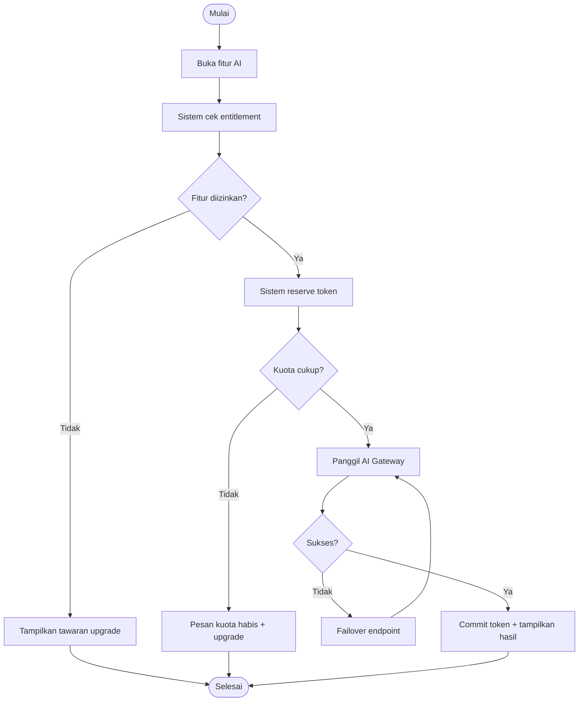
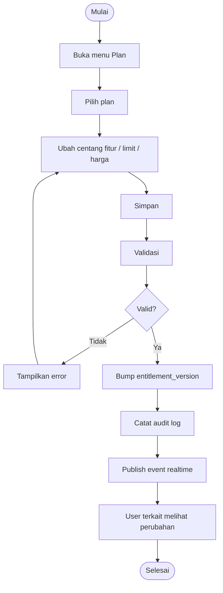
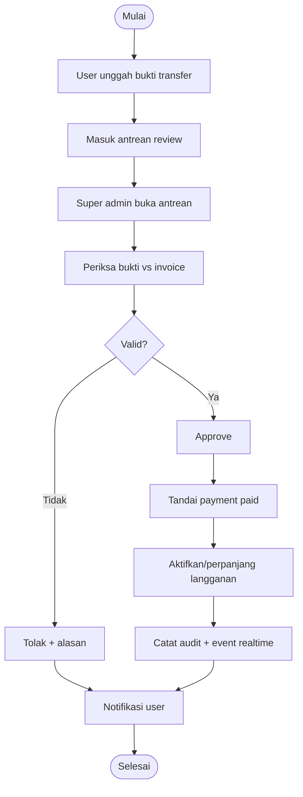
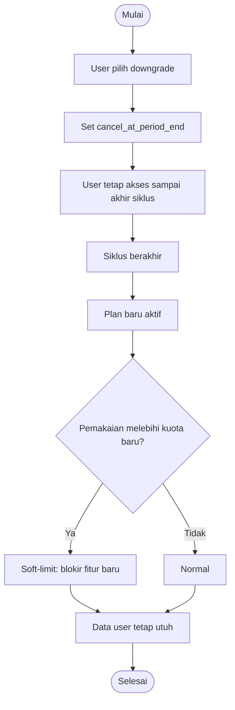

# Diagram — Activity FinTrack v2

## 1. Activity: User Memakai Fitur AI sampai Kuota Habis

## 2. Activity: Super Admin Mengubah Plan

## 3. Activity: Review Pembayaran Manual

## 4. Activity: Downgrade di Akhir Siklus

