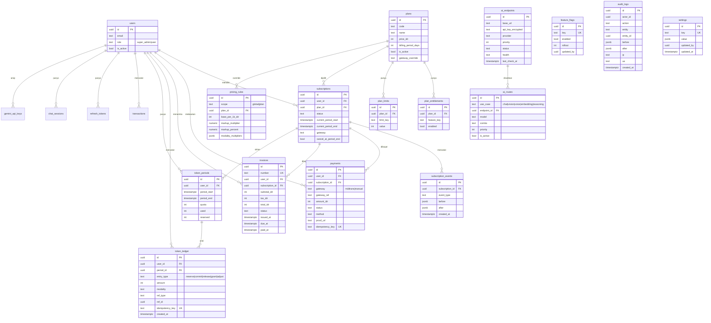

# Diagram — ERD FinTrack v2 (Setelah Penambahan)

> Tabel lama dipertahankan. Yang baru ditambahkan untuk subscription, token, pembayaran, AI gateway,
> dan platform. `gemini_api_keys` diarsipkan (tetap ada), `transaction_embeddings` tetap `vector(768)`.

**Catatan integritas:**
- Semua FK uang menuju `users`/`subscriptions`; `ON DELETE` dipilih hati-hati (data billing tidak
  ikut terhapus sembarangan).
- `token_ledger` **append-only**: tidak ada `UPDATE`/`DELETE` (kecuali kebijakan retensi tertulis).
- `payments.idempotency_key` dan `token_ledger.idempotency_key` **UNIQUE** → anti double-charge.
- Nilai uang = **integer** (`price_idr`, `amount_idr`, `total_idr`).
