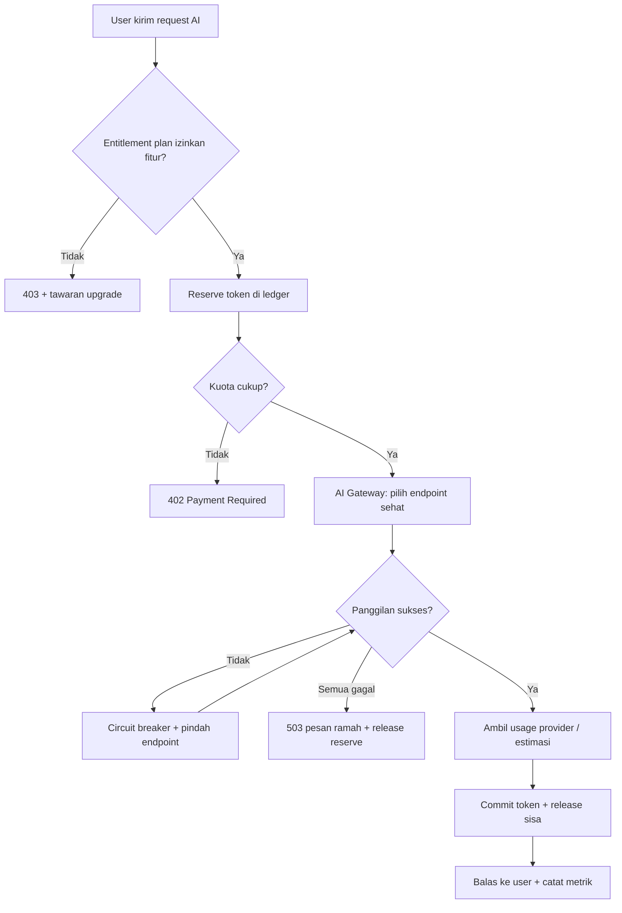
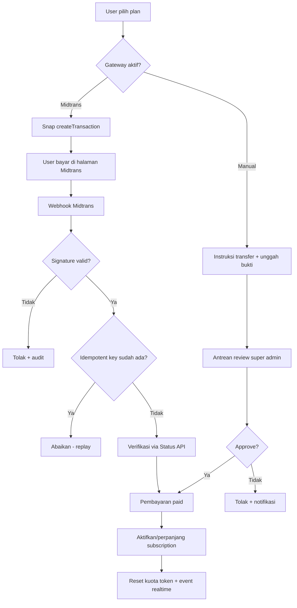
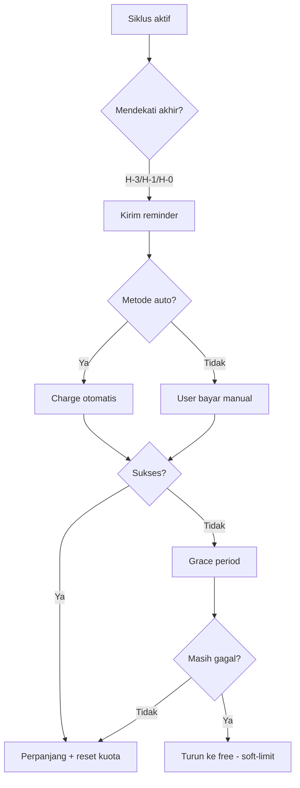
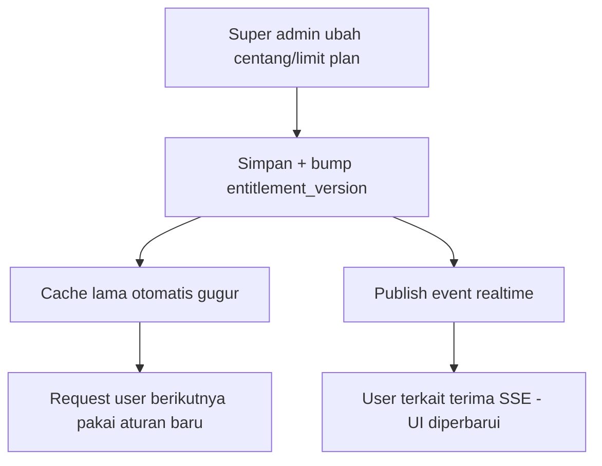

# Diagram — Flowchart Sistem FinTrack v2

## 1. Alur Pemakaian AI (metering token)

## 2. Alur Berlangganan & Pembayaran

## 3. Alur Siklus Langganan (per-hari, hybrid renewal)

## 4. Alur Perubahan Entitlement (realtime)

