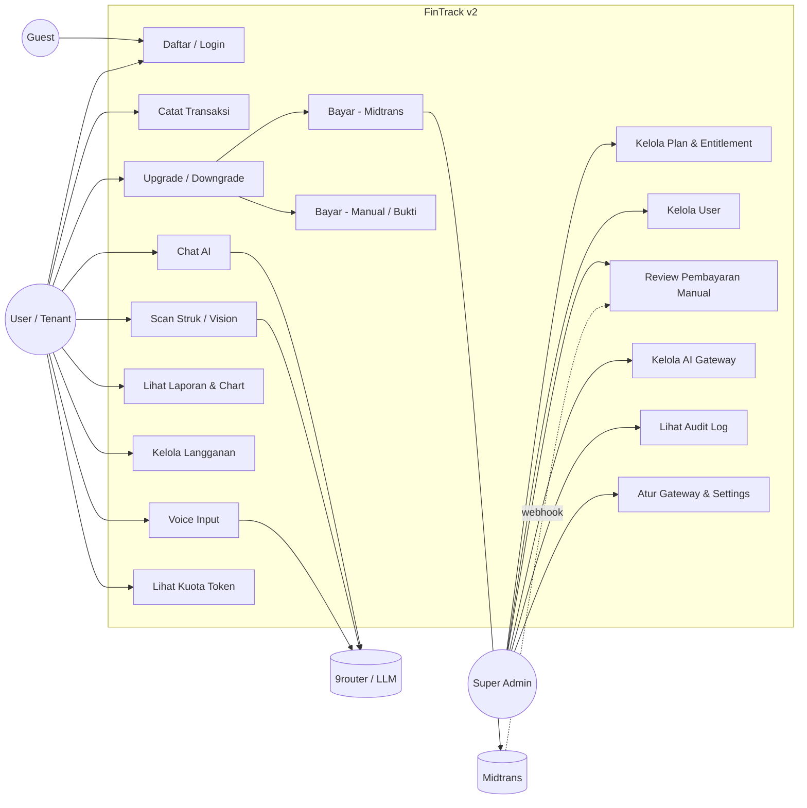

# Diagram — Use Case FinTrack v2

**Catatan:**
- `User` hanya dapat memakai fitur yang diizinkan oleh **entitlement plan**-nya (dicek backend).
- `SuperAdmin` mengelola platform; tidak ada role lain (keputusan K-02).
- Pembayaran manual & Midtrans bermuara ke aktivasi langganan yang sama.
